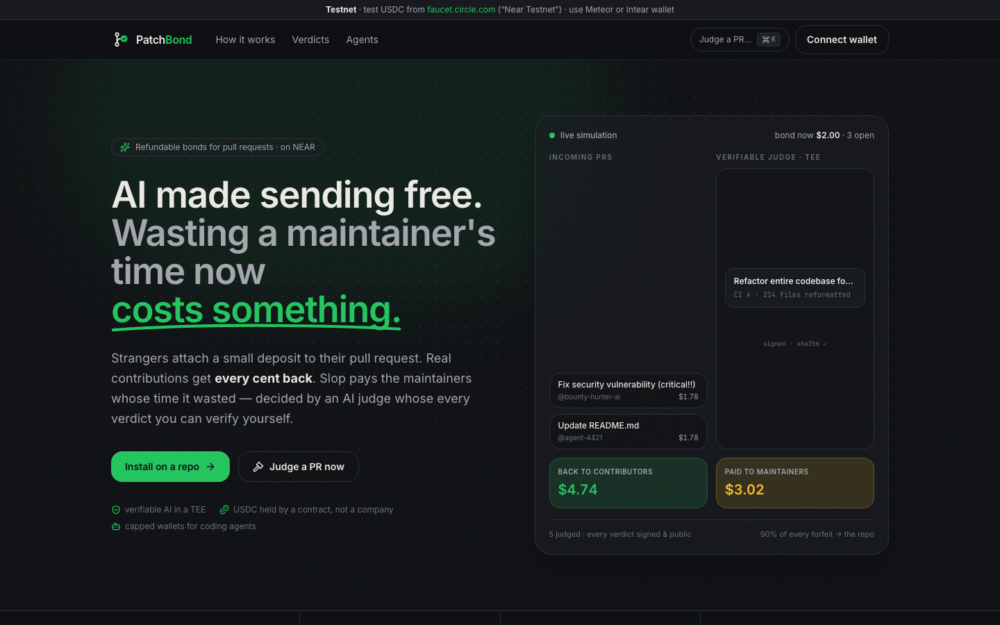
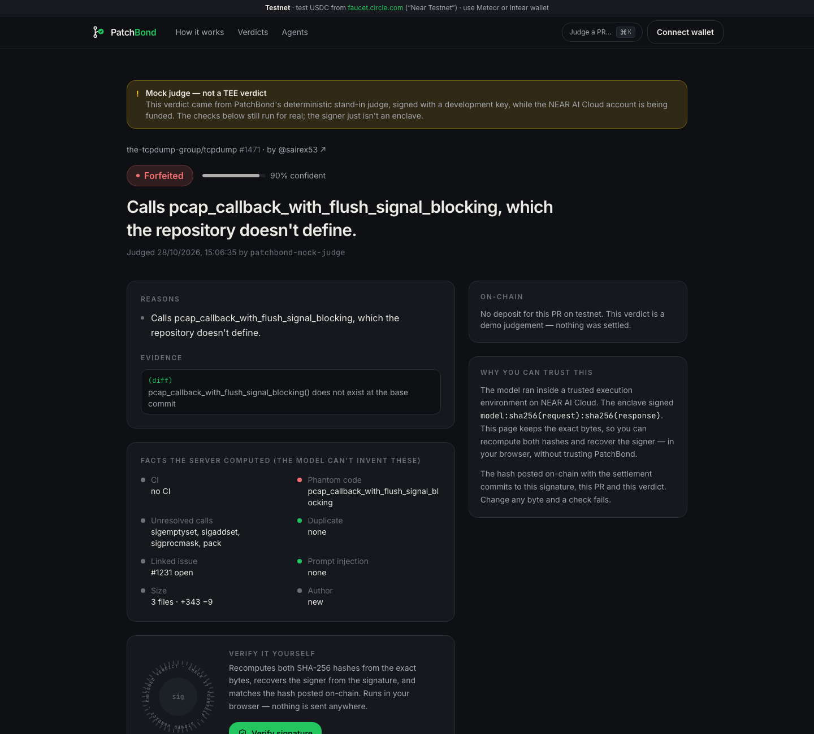
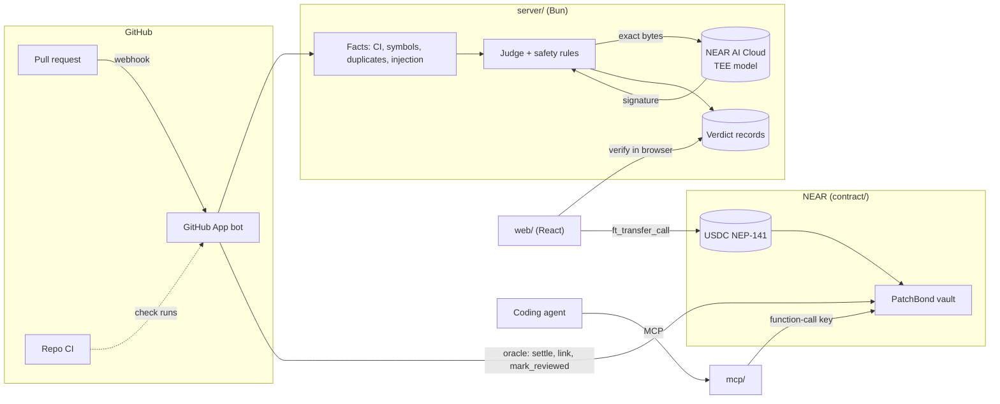

<p align="center">
  
</p>

<p align="center">
  <b>AI made sending free. PatchBond makes wasting a maintainer's time cost something — and pays the maintainer whose time was wasted.</b>
</p>

<p align="center">
  <a href="https://github.com/PatchBond/patchbond/actions/workflows/ci.yml"></a>
  
  
</p>

---

PatchBond puts a small **refundable bond** on unsolicited pull requests. A stranger opens a PR; PatchBond asks for a deposit in USDC on NEAR. An **AI judge running in a TEE on NEAR AI Cloud** reviews it, using facts we compute (CI, functions that don't exist, duplicates, prompt injection). A real contribution gets **every cent back**. Slop is **forfeited to the repo's vault** in our NEAR contract. Every verdict is public, signed, and checkable in your browser.

It is a **market for maintainer attention — EIP-1559 for open source**: the bond follows an on-chain price curve over the repo's queue, so a spam wave prices itself out while a quiet repo costs a newcomer a few cents.



## Contents

- [Why this exists](#why-this-exists) · [How it works](#how-it-works) · [What makes it different](#what-makes-it-different)
- [Try it in 5 minutes](#try-it-in-5-minutes) — for judges and reviewers, from a clean clone
- [What's real](#whats-real) — an honest built-vs-planned table
- [Architecture](#architecture) · [NEAR features used](#near-features-used) · [Security model](#security-model)
- [Testing](#testing) · [Judge accuracy](#judge-accuracy) · [Running your own](#running-your-own)
- [Libraries and AI-assisted code](#libraries-and-ai-assisted-code) · [License](#license)

## Why this exists

> I maintain an open-source project that a large community contributes to. Lately a pattern keeps repeating: people open tens of pull requests for issues they were never assigned, or describe changes their PR doesn't actually contain. Every one of them costs a maintainer time to read, check and close — time taken from the people doing real work. AI is here to help open source, not to drown it. So I built PatchBond on NEAR.
>
> — the PatchBond team

PatchBond answers each part of that pattern directly:

| The pattern | What PatchBond does |
|---|---|
| Tens of PRs at once | **Attention pricing**: every extra open submission makes the next bond 12.5% more expensive — a flood prices itself out. |
| PRs for issues assigned to someone else | **Assignment check**: a fact read from GitHub; repos that require assignment can treat it as forfeit evidence. |
| "Claims he did what he didn't do" | **Claims vs diff**: every claim of work in the description is matched against the diff; claims with nothing behind them become evidence. |
| Maintainers paying for it all with their time | **Slop pays the maintainer**: forfeited bonds go to the repo's vault. |

### The wider problem

- A Linux Foundation study (Oct 2026) estimates **~25% of incoming pull requests are low-quality AI output** (31% on large projects).
- curl moved low/medium-severity security reports to public view because AI-generated reports nearly overwhelmed its team; GitHub is adding options to limit or turn off pull requests.
- The sender spends ten seconds. The maintainer spends an hour. Nothing connects the two — until the sender has skin in the game.

## How it works

```
 Stranger opens PR ──► PatchBond comment: "refundable $2.25 deposit" (price follows the queue)
        │
        ▼
 Pays with a NEAR wallet (USDC ft_transfer_call) ──► bond held by the contract, not a company
        │
        ▼
 Repo's CI finishes ──► facts computed ──► verifiable model in a TEE ──► signed verdict
        │
        ├── refund  ──► every cent back (+ builds on-chain reputation; proven people pay $0)
        ├── forfeit ──► 90% to the repo's vault, 10% to run PatchBond
        └── needs_human ──► the maintainer decides (no decision in 14 days → refunded)
        │
        ▼
 Verdict is proposed on-chain ──► 72 h challenge window ──► finalized (anyone can)
```

Maintainers, collaborators and proven contributors (≥3 refunds on ≥2 repos, no recent forfeit) are never asked to pay. **When in doubt, PatchBond refunds**: a forfeit needs high confidence *and* concrete evidence, and clean CI plus real code can't be forfeited by the model alone.

## What makes it different

Free slop *detectors* exist. PatchBond is not a code reviewer and detection isn't the edge — the mechanisms are. All of them are enforced by one NEAR contract ([`contract/vault/src`](contract/vault/src)):

| Mechanism | What it does | Where |
|---|---|---|
| **Attention pricing** | `bond = clamp(min, max, base × 1.125^(open − capacity)) × reputation`, computed on-chain from unsettled deposits — no oracle. | [`curve.rs`](contract/vault/src/curve.rs) |
| **Optimistic AI verdicts** | A cheap verifiable model decides; either side stakes the bond to challenge; a stronger model re-judges; the loser's stake pays the winner. The maintainer keeps the final word but can't judge their own challenge. | [`settle.rs`](contract/vault/src/settle.rs) |
| **Priority lane** | An optional review tip goes to the repo **only if a maintainer reviews within the promised window** — otherwise it's refunded. Pays for attention, never for submitting. | [`settle.rs`](contract/vault/src/settle.rs) |
| **Slop funds the fix** | A forfeited PR that claimed to fix issue #N becomes a bounty on #N, paid automatically to whoever's real fix is merged. | [`settle.rs`](contract/vault/src/settle.rs) |
| **Agent passports** | Coding agents pay from a capped in-contract budget with a **function-call key** that can call one method. They declare operator, harness and model; every harness gets a public refund/forfeit record. | [`budget.rs`](contract/vault/src/budget.rs) |
| **Verifiable verdicts** | We keep the exact request/response bytes and NEAR AI's TEE signature; the verdict page recomputes both hashes and recovers the signer **in your browser**, and the hash settled on-chain commits to all of it. | [`shared/src/verify.ts`](shared/src/verify.ts) |

<p align="center"></p>

## Try it in 5 minutes

Every step below works from a clean clone on macOS or Linux. Nothing needs a wallet until step 5.

**Prerequisites:** [Bun](https://bun.sh) ≥ 1.4, Rust stable with `wasm32-unknown-unknown`, [`cargo-near`](https://github.com/near/cargo-near) ≥ 0.22. Optional: [`near-cli-rs`](https://github.com/near/near-cli-rs), the `gh` CLI (raises GitHub rate limits automatically).

```bash
git clone https://github.com/PatchBond/patchbond && cd patchbond
bun install
cp .env.example .env          # defaults work: testnet, mock judge
```

| # | Do | See |
|---|---|---|
| 1 | `bun run typecheck && (cd shared && bun test) && (cd server && bun test) && (cd mcp && bun test)` | **64 TypeScript tests pass** — judge facts and safety rules, the GitHub bot against a fake GitHub, maintainer sign-in and NEP-413 wallet linking, pre-flight, the MCP server over real stdio. |
| 2 | `cd contract && cargo near build non-reproducible-wasm --manifest-path vault/Cargo.toml && cargo near build non-reproducible-wasm --manifest-path mock-ft/Cargo.toml && cargo test -p patchbond-vault` | **33 contract tests pass**: 10 unit (incl. a 50,000-case property test of the money split) + 23 on a local NEAR sandbox with real token transfers (every money path, challenges, a real function-call key, link-once, pause). |
| 3 | `bun run --cwd server judge-pr https://github.com/the-tcpdump-group/tcpdump/pull/1471` | A **forfeit**: the PR calls `pcap_callback_with_flush_signal_blocking`, which doesn't exist in libpcap's own `pcap_*` namespace. `"verifies": true`. Try `https://github.com/tj/commander.js/pull/2637` → **refund**. |
| 4 | `bun run dev`, then open <http://localhost:5317> | The app: drag the bond curve, press **Simulate a spam wave**, ⌘K → paste any PR URL → open the verdict → **Verify signature** (hashes + signer + on-chain hash, checked in the browser). |
| 5 | On testnet, with test USDC from [faucet.circle.com](https://faucet.circle.com) ("Near Testnet") and a Meteor or Intear wallet: open <http://localhost:5317/pay/1/1?repo=PatchBond/playground&user=YOUR_GITHUB_LOGIN> | Pay a real bond into the live contract [`patchbond-dev.testnet`](https://testnet.nearblocks.io/address/patchbond-dev.testnet). The page shows the live quote from the on-chain curve. |
| 6 | `bun run --cwd server e2e:testnet` (needs a funded testnet parent account; see [`server/e2e/testnet.ts`](server/e2e/testnet.ts)) | The full money flow on **real testnet**: 49 transactions — including a gasless bond through the relayer and an agent paying via the MCP server — then every account is deleted. Last report: [`docs/e2e/testnet-report.md`](docs/e2e/testnet-report.md) — one explorer link per transaction. |

### For coding agents (MCP)

```bash
claude mcp add patchbond -e PATCHBOND_API=http://localhost:8787 -- bun "$PWD/mcp/src/index.ts"
```

Read-only works with no wallet (`patchbond_policy`, `patchbond_preflight`, `patchbond_status`, `patchbond_reputation`). To pay bonds, add `PATCHBOND_AGENT_ACCOUNT`, `PATCHBOND_AGENT_KEY` (a function-call key limited to `deposit_from_budget`) and `PATCHBOND_OPERATOR`. **The server refuses to start with a full-access key.** Setup steps are on the app's **Agents** page.

| Tool | Does |
|---|---|
| `patchbond_policy(repo)` | Does the repo use PatchBond, what's the bond right now, am I exempt? |
| `patchbond_preflight(pr_url)` | **Free**: the judge's deterministic checks on your PR and the likely verdict, before paying. |
| `patchbond_deposit(pr_url)` | Pays from your capped budget with your function-call key; records your passport. |
| `patchbond_status(pr_url)` | Bond state (held / proposed / challenged / settled) and the verdict with reasons. |
| `patchbond_budget()` · `patchbond_reputation()` · `patchbond_appeal()` | Budget left today; on-chain reputation and your harness's record; attach a note to a verdict. |

## What's real

Honest status on 2026-10-28. Testnet is the reproduce-it-yourself path; the final demo runs on mainnet.

| Part | Status |
|---|---|
| Vault contract: bonds, curve, refund/forfeit 90/10, void, tips, bounties, withdraw, challenges, agent budgets, reputation, NEP-297 events, link-once + hand-over, pause, state migration | ✅ Built, 33 tests, **live on testnet** ([`deploy/testnet.json`](deploy/testnet.json)), full e2e on testnet |
| AI judge: facts (CI, phantom vs unresolved symbols, duplicates, linked issue, **issue assignment**, **claims vs diff**, injection), prompt, server safety rules, record + verification | ✅ Built and tested; 0/15 good PRs forfeited on the labelled set |
| NEAR AI Cloud verifiable model (`z-ai/glm-5.3-flash`) | ⚠️ Client built; **running on a clearly labelled mock judge** (dev-key signatures, every record marked `mock`) until the NEAR AI account has credits |
| GitHub App bot: pay-link comment, check runs, deposit watch, judge after CI, settle, finalize, review → tip, merge → bounty, 14-day refund | ✅ Built, 8 scenario tests against a fake GitHub; live App being set up |
| Web app: home, pay, verdict with in-browser verification, repo, agents, ⌘K | ✅ Built |
| MCP server for agents (7 tools, key safety check) | ✅ Built, paid a real bond on testnet in the e2e |
| Maintainer dashboard: GitHub sign-in, NEP-413 wallet proof → `link_repo`, withdraw, bond-policy editor with live price preview, needs-human queue | ✅ Built, 6 tests (forged signature, wrong account, function-call key, replay, non-admin, CSRF) |
| Re-judging challenges with a stronger model (Kimi K3) seeing both sides' statements, then `resolve_challenge` | ✅ Built and tested (runs on the mock until NEAR AI credits) |
| Payout to another chain via NEAR Intents 1Click (Base, Arbitrum, Ethereum, Solana) | ✅ Live **dry-run quotes** from the real 1Click API in the dashboard (Intents has no testnet); the mainnet withdraw-and-bridge runs only with the team's go-ahead |
| Payout to a Sputnik DAO / Trezu treasury | ✅ `set_payout` hands a repo to a DAO account, which then withdraws by proposal |
| Gasless contributors (NEP-366): the wallet signs a delegate action, our relayer pays the gas; the relayer only forwards bond/challenge payments into PatchBond | ✅ Built; on the pay page by default (Meteor, Intear, HOT); proven on testnet — the contributor spent 0 yoctoNEAR |
| On-chain verification of the TEE signature (`ecrecover`); sealed security reports | 🧪 Stretch (feasibility proven in a throwaway test) |
| Bank/card payouts, GitLab, a token | ❌ Out of scope. **No token, ever. Nobody is paid for submitting.** |

## Architecture



| Folder | What | Tech |
|---|---|---|
| [`contract/`](contract) | The vault (+ a test-only NEP-141 token) | Rust, near-sdk 5.30, cargo-near, near-workspaces |
| [`server/`](server) | GitHub App bot, judge, verdict API, CLI tools, testnet e2e | Bun, Hono, Octokit, near-api-js 7 |
| [`web/`](web) | Pay, verdicts with in-browser verification, maintainer dashboard, repo and agent pages | React 19, Vite, Tailwind 4, shadcn/ui, Motion, NEAR Connect |
| [`mcp/`](mcp) | MCP server for coding agents | `@modelcontextprotocol/sdk` |
| [`shared/`](shared) | Verdict schema, verification, the bond curve (identical to the contract's) | TypeScript, viem, zod |

The trust boundary is stated plainly: the contract trusts our **oracle** account for GitHub facts (who is admin, PR state, CI), because a contract can't read GitHub. The **AI verdict itself is independently verifiable**, every forfeit is challengeable with a stake, and the oracle can't move vault funds.

## NEAR features used

| Feature | Where |
|---|---|
| Rust smart contract (near-sdk 5), NEP-297 events | [`contract/vault/src/lib.rs`](contract/vault/src/lib.rs), [`events.rs`](contract/vault/src/events.rs) |
| NEP-141 USDC + `ft_transfer_call` / `ft_on_transfer` (bonds, challenges, budgets) | [`deposit.rs`](contract/vault/src/deposit.rs), [`web/src/pages/Pay.tsx`](web/src/pages/Pay.tsx) |
| Cross-contract calls with callbacks (every payout books money back on failure) | [`payout.rs`](contract/vault/src/payout.rs) |
| **Function Call access keys** as capped agent wallets (method-limited; can't attach deposits) | [`budget.rs`](contract/vault/src/budget.rs), [`mcp/src/client.ts`](mcp/src/client.ts) |
| **NEAR AI Cloud** verifiable inference + TEE signatures | [`server/src/judge/nearai.ts`](server/src/judge/nearai.ts), [`shared/src/verify.ts`](shared/src/verify.ts) |
| NEAR Connect wallet selector (testnet-capable wallets only on testnet) | [`web/src/lib/wallet.tsx`](web/src/lib/wallet.tsx) |
| Named accounts / sub-accounts (contract, oracle, throwaway e2e stacks) | [`deploy/testnet.json`](deploy/testnet.json), [`server/e2e/testnet.ts`](server/e2e/testnet.ts) |
| NEAR Intents 1Click (cross-chain payout quotes) | [`server/src/intents.ts`](server/src/intents.ts), dashboard → Vault |
| Sputnik DAO / Trezu as payout accounts (`set_payout`) | [`lib.rs`](contract/vault/src/lib.rs) |
| **Meta transactions (NEP-366)** — gasless bonds through our relayer | [`server/src/relayer.ts`](server/src/relayer.ts), [`web/src/lib/wallet.tsx`](web/src/lib/wallet.tsx) |

## Security model

Full threat model, key powers and known limits: **[SECURITY.md](SECURITY.md)**.


- **Nobody can take a repo's vault** except its linked payout account — not the contract owner, not the oracle; a stolen oracle key can't even relink a linked repo ([tests](contract/vault/tests/money_paths.rs)).
- **Every outgoing transfer has a callback** that books the money back (vault, treasury, budget or the receiver's claimable balance) if the transfer fails. Book-keeping happens before transfers, so nothing can be paid twice.
- **Agents hold only a function-call key** limited to `deposit_from_budget`; the contract enforces the daily cap and the budget. The MCP server checks the key on-chain and refuses full-access keys. On testnet, the e2e proves the key can't call the token or any other method.
- **Prompt injection**: contributor text is fenced as untrusted data, our tags are neutralised, injection attempts are themselves evidence, and the output must match a strict schema.
- **The model can't forfeit on its own**: a forfeit needs confidence ≥ the repo's threshold, at least one concrete piece of evidence, and a hard fact (failing CI, phantom code, a duplicate or injection). A failed lookup never becomes an accusation. Library calls the repo doesn't define are "unresolved", never "phantom".
- **Webhooks are HMAC-verified**; forged deliveries are rejected ([test](server/test/bot.test.ts)). Secrets live in `.env` (git-ignored); keys never leave the machine.
- **Repo linking** needs both a GitHub sign-in proving admin rights (checked again at the moment of linking) and a NEP-413 signature from a **full-access** key of the payout account; challenges are single-use and expire in 10 minutes; the OAuth flow is CSRF-protected ([tests](server/test/maintainers.test.ts)).
- **Griefing**: a deposit paid for someone else's PR is voided (full refund, no reputation effect) and the real author can still pay.

## Testing

| Suite | Count | Command |
|---|---|---|
| Contract unit tests (curve, exemption, forfeit tax, money-split property test) | 10 | `cd contract && cargo test -p patchbond-vault --lib` |
| Contract sandbox tests (real NEP-141 transfers on a local NEAR node) | 23 | `cd contract && cargo test -p patchbond-vault` |
| Server: judge facts (incl. assignment and claims-vs-diff), rules, pre-flight, GitHub bot vs fake GitHub (incl. challenge re-judging), maintainer onboarding, Intents quotes, relayer | 47 | `cd server && bun test` |
| MCP: client, key safety, stdio protocol | 11 | `cd mcp && bun test` |
| Shared: verification tamper tests, curve = contract values | 6 | `cd shared && bun test` |
| **End-to-end on real NEAR testnet** | 49 tx | `bun run --cwd server e2e:testnet` → [report](docs/e2e/testnet-report.md) |

CI runs the TypeScript and contract suites on every push ([workflow](.github/workflows/ci.yml)).

## Judge accuracy

Measured on a labelled set of 30 real PRs ([`docs/eval/candidates.json`](docs/eval/candidates.json): slop = closed PRs maintainers labelled AI slop; good = authors' first merged PR). `bun run --cwd server eval`.

| Judge | Good PRs forfeited | Slop forfeited | needs_human |
|---|---|---|---|
| Facts layer only (mock model) | **0 / 15** | 2 / 15 | 13% |
| NEAR AI `glm-5.3-flash` | pending credits | pending | pending |

The target is **zero good PRs forfeited**; a high `needs_human` rate is acceptable. Results: [`docs/eval/results-mock.json`](docs/eval/results-mock.json).

## Running your own

1. Deploy: `cd contract/vault && cargo near deploy build-non-reproducible-wasm <account> with-init-call new json-args '{"owner":"…","oracle":"…","treasury":"…","token":"<USDC>"}' …`, then register the contract with USDC (`storage_deposit`). Write the accounts to `deploy/<network>.json`.
2. `cp .env.example .env`; set `NEAR_NETWORK`, `JUDGE_MODE=nearai` + `NEARAI_API_KEY`, and the oracle key (or keep it in near-cli's keychain).
3. `bun run dev`, open <http://localhost:8787/setup> and click **Create on GitHub** — the App is created from a manifest with the right permissions and its credentials are saved to `.env`. For local webhooks set `WEBHOOK_URL` to a [smee.io](https://smee.io/new) channel; `bun run dev` starts the tunnel.
4. Install the App on a repository. Outside PRs now get a deposit request.

All network-specific values (accounts, USDC contract, RPC) come from `deploy/<network>.json` and `.env` — the same code runs on testnet and mainnet.

## Libraries and AI-assisted code

As the hackathon rules ask (Q-005): the project uses open-source libraries including near-sdk, near-contract-standards, near-workspaces, cargo-near, near-api-js, NEAR Connect (`@hot-labs/near-connect`), Octokit, Hono, viem, zod, the MCP TypeScript SDK, React, Vite, Tailwind CSS, shadcn/ui (Radix), Motion, sonner, cmdk and lucide icons. Parts of the code were written with AI coding assistants, directed and reviewed by the team. No templates were used.

## License

[MIT](LICENSE) © the PatchBond team.
