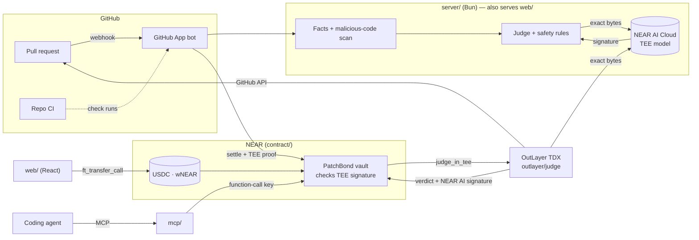

<p align="center">
  
</p>

<p align="center">
  <b>AI made sending free. PatchBond makes wasting a maintainer's time cost something — and the AI judging it can't touch the money.</b>
</p>

<p align="center">
  <a href="https://patchbond-production.up.railway.app"></a>
  <a href="https://github.com/PatchBond/patchbond/actions/workflows/ci.yml"></a>
  
  <a href="docs/OUTLAYER.md"></a>
  
</p>

---

Strangers attach a small **refundable bond** to their pull request, in USDC or NEAR. An **AI judge in a TEE on NEAR AI Cloud** reviews it after CI. Real work gets **every cent back**; slop is **forfeited to the maintainers whose time it wasted**. The bond follows an on-chain price curve over the repo's queue — **EIP-1559 for open source**: a spam wave prices itself out, a quiet repo costs a newcomer cents. And the AI can't touch the money: **the contract only forfeits a bond if NEAR AI's enclave signed that verdict**, checked on-chain. With **OutLayer**, even our server leaves the loop: the contract has the PR judged inside an Intel TDX enclave that reads GitHub itself ([how](docs/OUTLAYER.md)).

<!-- live:start -->
### Live now — [patchbond-production.up.railway.app](https://patchbond-production.up.railway.app)

| | |
|---|---|
| Bonds paid on-chain | **2** |
| Refunded to real contributors | **$0.00** |
| Forfeited to maintainers | **$2.00** |
| Unpaid PRs closed after their 24 h notice | **0** |
| TEE-signed verdicts on the hosted service | **2** (PRs handled there: 0) · the contract trusts 2 NEAR AI keys |

<sub>testnet · contract [`patchbond-dev.testnet`](https://testnet.nearblocks.io/address/patchbond-dev.testnet) · updated 2026-10-30 by [`scripts/live-stats.ts`](scripts/live-stats.ts) from the contract's own views and the hosted service</sub>
<!-- live:end -->


**Contents:** [Why](#why-this-exists) · [How it works](#how-it-works) · [What's different](#what-makes-it-different) · [Why on-chain](#why-on-chain) · [Objections](#objections) · [Try it in 5 minutes](#try-it-in-5-minutes) · [What's real](#whats-real) · [Check our claims](#check-our-claims) · [Judge quality](#judge-quality) · [Tracks](#how-it-maps-to-the-tracks) · [Security](#security-model) · [Architecture](#architecture) · [NEAR features](#near-features-used) · [Testing](#testing) · [Run your own](#running-your-own)

## Why this exists

> I maintain [Sanctifier](https://github.com/HyperSafeD/Sanctifier), a security and formal-verification suite for Stellar Soroban, which **122 people have contributed to** ([contributors](https://github.com/HyperSafeD/Sanctifier/graphs/contributors)) through **571 pull requests** ([all PRs](https://github.com/HyperSafeD/Sanctifier/pulls?q=is%3Apr)). Lately a pattern keeps repeating: people open tens of pull requests for issues they were never assigned, or describe changes their PR doesn't actually contain. Every one costs a maintainer time to read, check and close. AI is here to help open source, not to drown it. So I built PatchBond on NEAR — and it now runs on Sanctifier.
>
> — the PatchBond team

| The pattern | What PatchBond does |
|---|---|
| Tens of PRs at once | **Attention pricing**: every extra open submission makes the next bond 12.5% more expensive. |
| PRs for issues assigned to someone else | **Assignment check**, read from GitHub; repos can make it forfeit evidence. |
| "Claims he did what he didn't do" | **Claims vs diff**: every claim of work in the description is matched against the diff. |
| Maintainers paying for it all with their time | **Slop pays the maintainer**: forfeited bonds go to the repo's vault. |

The wider problem: a Linux Foundation study (Oct 2026) estimates **~25% of incoming pull requests are low-quality AI output** ([Phoronix](https://www.phoronix.com/news/Linux-Foundation-25p-AI-Slop), [The Register](https://www.theregister.com/ai-and-ml/2026/10/21/ai-cuts-coding-time-but-its-also-filling-open-sources-inbox-with-crap/5304389)); curl moved low-severity reports public after AI reports nearly overwhelmed it. The sender spends ten seconds, the maintainer an hour — until the sender has skin in the game.

## How it works

```
 Stranger opens PR ──► bot comment: "refundable $0.78 deposit — pay within 24 h" (price follows the queue)
        │                    └─ unpaid after 24 h → closed (paying later reopens it)
        ▼
 Pays from a NEAR wallet: USDC (gasless) or NEAR (wrapped in the same tx) ──► held by the contract
        │
        ▼
 Repo's CI finishes ──► facts computed ──► verifiable model in a TEE ──► signed verdict
        ├── refund      ──► every cent back, on-chain reputation (proven contributors pay $0)
        ├── forfeit     ──► the contract checks NEAR AI's signature ──► 90% repo vault · 10% PatchBond
        └── needs_human ──► the maintainer decides (none in 14 days → refunded)
        ▼
 Proposed on-chain ──► 72 h challenge window (a stronger model re-judges) ──► finalized
```

Maintainers, collaborators and proven contributors (≥3 refunds on ≥2 repos, no recent forfeit) never pay. **When in doubt, PatchBond refunds.**

## What makes it different

Free slop *detectors* exist; PatchBond isn't a code reviewer. The edge is the mechanism — all enforced by one NEAR contract ([`contract/vault/src`](contract/vault/src)):

| Mechanism | What it does | Where |
|---|---|---|
| **Attention pricing** | `bond = clamp(min, max, base × 1.125^(open − capacity)) × reputation`, computed on-chain from unsettled deposits. | [`curve.rs`](contract/vault/src/curve.rs) |
| **Verdicts the contract enforces** | A forfeit needs NEAR AI's TEE-signed response: the contract recomputes its hash, recovers the signer with `ecrecover`, requires a key from NEAR AI's attestation report, and reads the model's own verdict, confidence and evidence. **Our own server can't invent a forfeit.** | [`tee.rs`](contract/vault/src/tee.rs) |
| **Optimistic verdicts** | A cheap verifiable model decides; either side can stake to challenge; a stronger model re-judges; the loser's stake pays the winner. | [`settle.rs`](contract/vault/src/settle.rs) |
| **Fair to contributors** | A maintainer refunds instantly but can only *propose* a forfeit (48 h, disputable for free); if a re-judge overturns it, the contributor gets a penalty from the vault. Every override is public. | [`settle.rs`](contract/vault/src/settle.rs) |
| **Malicious code** | A deterministic scan — Trojan Source Unicode, decoded-payload `exec`, `curl \| sh`, secret exfiltration, poisoned workflows and lockfiles — proposes a forfeit even if the model missed it. | [`malice.ts`](server/src/judge/malice.ts) |
| **Slop funds the fix** | A forfeited PR that claimed to fix issue #N becomes a bounty on #N, paid to whoever's real fix is merged. | [`settle.rs`](contract/vault/src/settle.rs) |
| **Agent passports** | Coding agents pay from a capped budget with a **function-call key** that can call one method, declaring operator, harness and model; every harness gets a public record. | [`budget.rs`](contract/vault/src/budget.rs) |

<p align="center"></p>

## Why on-chain

Why not just take card deposits? Because the payers are increasingly agents, and the judge is an AI:

- **Agents can't hold credit cards — they can hold capped keys.** A function-call key pays bonds and nothing else, under a daily cap the contract enforces.
- **No custodian.** Bonds sit in a contract; only the repo's linked payout account can withdraw. We can't freeze, seize or redirect them — not even with our own keys.
- **The AI can't touch the money.** The contract checks NEAR AI's TEE signature before any forfeit, so a compromised server can only refund.
- **Reputation is portable.** A contributor's refunds and forfeits are public on-chain, readable by any repo or tool — proven people pay $0 everywhere.
- **Global by default.** Anyone with a NEAR wallet pays in USDC (gasless) or NEAR; maintainers withdraw to NEAR, a DAO, or another chain via NEAR Intents.

## Objections

| Objection | Answer |
|---|---|
| "A bond scares off newcomers." | Maintainers, collaborators and proven contributors pay $0. A quiet repo charges cents, real work is refunded in full automatically, the 24 h deadline is announced up front, and every repo can turn bonds or auto-close off. |
| "The judge only flags 8 of 15 slop PRs." | Detection isn't the product — the bond is. A spammer must pay *before* any judgement, unpaid PRs close themselves, and a flood raises the price for everyone in it. The judge's job is never to take a good contributor's money: **0 of 15** good PRs forfeited. |
| "A rich spammer just pays." | Then the maintainer is paid for their time — that's the point. Each forfeit multiplies that account's next bond (×2–×4) and is public on-chain. |
| "Can PatchBond or the maintainer steal deposits?" | No. Only the linked payout account withdraws; our oracle can't forfeit without NEAR AI's signature; a maintainer's forfeit is a free-to-dispute proposal with a penalty if wrong. |
| "Can your server feed the model false facts?" | Every verdict publishes the exact request, so anyone can check it against GitHub. And with **OutLayer** on, the server isn't in the loop at all: anyone calls `judge_in_tee`, an Intel TDX enclave fetches the PR from GitHub itself and asks NEAR AI, and the contract checks NEAR AI's signature in the callback ([docs/OUTLAYER.md](docs/OUTLAYER.md)). |
| "Isn't this pay-to-contribute, like tea.xyz?" | The opposite: nobody is ever paid for submitting. Spam *costs* money instead of earning it. No token. |

## Try it in 5 minutes

**Maintainers:** try it on your repo in 10 minutes — **[docs/MAINTAINERS.md](docs/MAINTAINERS.md)** (testnet, no real money).

**Fastest:** open the [live demo](https://patchbond-production.up.railway.app), press ⌘K, paste any public PR URL, then **Verify signature** on the verdict.

**The whole money story in one command** — no wallet, no keys, no GitHub (needs Rust + `cargo-near`):

```bash
git clone https://github.com/PatchBond/patchbond && cd patchbond && bun run demo
```

A local NEAR sandbox runs the real contract with real token transfers: a real PR's bond refunded; our own server **refused** a forfeit with no signature, a tampered one, and a genuine NEAR AI signature on a *refund*; then **NEAR AI's own enclave-signed forfeit** pays the maintainer 90%; the oracle can't withdraw the vault, the maintainer can; a 16-PR spam wave prices itself from $0.77 to $5.13; and an OutLayer enclave verdict recovered on-chain to NEAR AI's GLM key. [Sample output](docs/demo-output.txt).

From a clean clone (macOS or Linux). **Prerequisites:** [Bun](https://bun.sh) ≥ 1.4, Rust stable with `wasm32-unknown-unknown`, [`cargo-near`](https://github.com/near/cargo-near) ≥ 0.22; optionally `near-cli-rs` and `gh`.

```bash
git clone https://github.com/PatchBond/patchbond && cd patchbond
bun install
cp .env.example .env          # testnet by default; set NEARAI_API_KEY + JUDGE_MODE=nearai for the live TEE judge
```

| # | Do | See |
|---|---|---|
| 1 | `bun run typecheck && (cd shared && bun test) && (cd server && bun test) && (cd mcp && bun test)` | **102 TypeScript tests pass** — judge facts and rules, the malicious-code scan, the GitHub bot against a fake GitHub, maintainer sign-in and NEP-413 linking, the MCP server over real stdio. |
| 2 | `cd contract && cargo near build non-reproducible-wasm --manifest-path vault/Cargo.toml && cargo near build non-reproducible-wasm --manifest-path mock-ft/Cargo.toml && cargo near build non-reproducible-wasm --manifest-path mock-outlayer/Cargo.toml && cargo test -p patchbond-vault` | **54 contract tests pass** on a local NEAR sandbox with real token transfers — every money path in USDC and NEAR, challenges, maintainer safeguards, a real function-call key, TEE proofs with **genuine NEAR AI signatures**, and the OutLayer callback verifying a real enclave run. |
| 3 | `bun run --cwd server judge-pr https://github.com/tj/commander.js/pull/2637` | A **refund** with reasons, facts and `"verifies": true`; `…/OWASP/Nettacker/pull/1787` → **needs_human** (failing CI). With a NEAR AI key it's TEE-signed (~$0.0004); without one the same pipeline runs offline with a local key. |
| 4 | `bun run dev`, open <http://localhost:5317> | Drag the bond curve, **Simulate a spam wave**, ⌘K → judge a PR → **Verify signature** in the browser. |
| 5 | With test USDC from [faucet.circle.com](https://faucet.circle.com) ("Near Testnet") or test NEAR from [near-faucet.io](https://near-faucet.io), and a Meteor or Intear wallet: `/pay/1/1?repo=PatchBond/playground&user=YOUR_LOGIN` (or `/pay/2/1?repo=PatchBond/playground-near&user=…` for NEAR) | Pay a real bond into [`patchbond-dev.testnet`](https://testnet.nearblocks.io/address/patchbond-dev.testnet) at the live on-chain quote. |
| 6 | `bun run --cwd server e2e:testnet` (needs a funded testnet account) | **62 real testnet transactions** — every money path, a gasless bond, an agent via MCP, NEAR via the real `wrap.testnet` — then every account is deleted. [Last report](docs/e2e/testnet-report.md), one explorer link per transaction. |

**Coding agents (MCP):** `claude mcp add patchbond -e PATCHBOND_API=https://patchbond-production.up.railway.app -- bun "$PWD/mcp/src/index.ts"`. Read-only tools work with no wallet (`patchbond_policy`, free `patchbond_preflight`, `patchbond_status`, `patchbond_reputation`); `patchbond_deposit` pays with a function-call key limited to `deposit_from_budget` — **the server refuses to start with a full-access key**. Setup is on the app's **Agents** page.

## What's real

Honest status on 2026-10-30. Testnet is the reproduce-it-yourself path; mainnet follows with the team's go-ahead.

| Part | Status |
|---|---|
| Vault contract: USDC or NEAR bonds per repo, curve, refund/forfeit, void, tips, bounties, challenges, maintainer safeguards, agent budgets, reputation, NEP-297 events, link-once, pause, upgrades | ✅ **Live on testnet** ([`deploy/testnet.json`](deploy/testnet.json)), 54 tests, full e2e |
| On-chain check of NEAR AI's TEE signature before any forfeit | ✅ **Live on testnet** with NEAR AI's GLM enclave key and the gateway key bound to Kimi K3 (`get_tee_signers`) |
| **Judging in OutLayer** (`judge_in_tee`): the judge as a wasm program in Intel TDX — fetches the PR from GitHub itself, asks NEAR AI, the contract verifies the signature in the callback; byte-identical prompts to the server's (parity test, 30 real PRs) | ✅ **Live on testnet** — first run: [tx `GTZM613J…`](https://testnet.nearblocks.io/txns/GTZM613JkwxhDoEafaBsEmX5tFr4SGwEQ3SaVtAh6Hr4) (24.5 s in the enclave, 0.0036 NEAR, NEAR AI's GLM key recovered on-chain); the hosted bot now judges paid PRs this way |
| AI judge on NEAR AI Cloud (`z-ai/glm-5.3-flash`, re-judges by `moonshotai/kimi-k3`) | ✅ **Live**, TEE-signed, $0.00035 a verdict; 0/15 good PRs forfeited |
| GitHub App bot: deposit comment + 24 h deadline, labels, check runs, deposit watch, judge after CI, settle, @mention on payment, review → tip, merge → bounty | ✅ **Live** as the [`patchbond` App](https://github.com/apps/patchbond) on Sanctifier — first real PR [#1972](https://github.com/HyperSafeD/Sanctifier/pull/1972) went comment → bond → verdict → settlement |
| Web app: pay, verdicts with in-browser verification, maintainer dashboard (sign-in, NEP-413 linking, withdraw, policy, activity), agents, ⌘K | ✅ **Live** at the demo URL |
| MCP server for agents (7 tools) | ✅ Paid a real bond on testnet in the e2e |
| Gasless bonds (NEP-366 relayer) | ✅ Proven on testnet — the contributor spent 0 NEAR |
| Payout to another chain via NEAR Intents 1Click | ✅ Live dry-run quotes (Intents has no testnet); the real bridge runs on mainnet |
| Payout to a Sputnik DAO / Trezu treasury (`set_payout`) | ✅ Built |
| Sealed security reports | 🧪 Not built |
| A token, or paying anyone for submitting | ❌ Never |

## How it maps to the tracks

| Track | What PatchBond does there | Where |
|---|---|---|
| **AI Security & Defense** — *"give AI money without giving it the keys"* | The AI never holds keys: the contract forfeits only what NEAR AI's enclave signed (`ecrecover` on-chain); with OutLayer the server leaves the loop and `exclusive` removes the oracle's forfeit power. Agents pay from **function-call keys** with contract-enforced daily caps; the MCP server refuses full-access keys. Prompt-injection and malicious-code scans, maintainer safeguards. | [`tee.rs`](contract/vault/src/tee.rs), [`outlayer.rs`](contract/vault/src/outlayer.rs), [`budget.rs`](contract/vault/src/budget.rs), [`malice.ts`](server/src/judge/malice.ts), [SECURITY.md](SECURITY.md) |
| **Agent Economy** — *agents that earn and spend* | Coding agents pay for maintainers' attention from capped budgets, declare a **passport** (operator, harness, model), and build a public refund/forfeit record per agent and per harness; an agent's own reputation sets its price like anyone's. 7 MCP tools. | [`mcp/`](mcp/src), [`budget.rs`](contract/vault/src/budget.rs), the app's **Agents** page |
| **Privacy & Private AI** — *TEE, NEAR AI Cloud* | Verdicts from a verifiable model in a TEE, signed over the exact bytes; the judge itself runs in an Intel TDX enclave via OutLayer with secrets that only the vault can unlock. | [`nearai.ts`](server/src/judge/nearai.ts), [`outlayer/judge`](outlayer/judge), [docs/OUTLAYER.md](docs/OUTLAYER.md) |
| **Real-world** — *stablecoins, payments* | USDC (NEP-141) or NEAR bonds, gasless payments (NEP-366), payouts to any chain via NEAR Intents 1Click. | [`deposit.rs`](contract/vault/src/deposit.rs), [`relayer.ts`](server/src/relayer.ts), [`intents.ts`](server/src/intents.ts) |
| **Social Money** — *reputation-based access, Sputnik DAO / Trezu* | Portable on-chain reputation: proven contributors pay $0 everywhere; a repo's vault can pay out to a Sputnik DAO / Trezu treasury; slop on a claimed fix funds a bounty for the real fix. | [`lib.rs`](contract/vault/src/lib.rs), [`settle.rs`](contract/vault/src/settle.rs) |
| **Open Innovation** | **EIP-1559 for maintainer attention**: the price of a maintainer's time computed on-chain from their own queue. | [`curve.rs`](contract/vault/src/curve.rs) |

## Case study: NEAR's own core repo

We ran PatchBond on **[near/nearcore](https://github.com/near/nearcore)**'s open queue (186 PRs) on 2026-10-30. ~161 are NEAR's engineers — exempt as members of the `near` org. The **20 from strangers** were judged in NEAR AI's TEE for **$0.0074**: **13 refund, 7 to a maintainer, 0 forfeits** — genuine fixes, waiting a median **236 days** for review. PatchBond's answer there is signed triage, bonds returned as soon as the judge rules, and a priority lane that pays for a timely review. Signed records and write-up: [docs/eval/nearcore](docs/eval/nearcore/README.md).

## Check our claims

| Claim | Check it |
|---|---|
| The judge models exist and are verifiable | NEAR AI's public model list: <https://cloud-api.near.ai/v1/model/list> (`metadata.verifiable: true`) |
| The contract only forfeits on NEAR AI's signature | Call `get_tee_signers` on [`patchbond-dev.testnet`](https://testnet.nearblocks.io/address/patchbond-dev.testnet) and compare with `signing_address` in NEAR AI's attestation report (`GET /v1/attestation/report?model=…`) |
| A verdict wasn't edited | Any verdict on the [live demo](https://patchbond-production.up.railway.app) → **Verify signature** (runs in your browser) |
| The facts given to the model are true | Each verdict publishes the exact request bytes — diff, CI results, every computed fact — to compare with the PR on GitHub |
| Money moved on-chain | [`docs/e2e/testnet-report.md`](docs/e2e/testnet-report.md): 62 transactions, one explorer link each |
| Built during the hackathon | First commit 2026-10-28 (window: 2026-10-19 → 11-14); see the commit history |

## Judge quality

The judge is built for **precision, not recall**: it must never take a genuine contributor's money. Spam is stopped first by the bond itself — pay or the PR closes in 24 h, and a wave prices itself out — so the judge only has to be right about who gets their money back.

| Real PRs | Genuine work forfeited | Refunded automatically | To a maintainer | Forfeited |
|---|---|---|---|---|
| 15 good first PRs (authors' first merged PR) | **0** | 14 | 1 | 0 |
| 15 slop PRs (closed and labelled AI slop by maintainers) | — | 7 | 8 | 0 |
| 20 open stranger PRs on [near/nearcore](docs/eval/nearcore/README.md) | **0** | 13 | 7 | 0 |

**0 of 35 genuine contributions forfeited.** Honest limits: on the labelled slop the model sent 8 of 15 to a human and refunded 7 (these slop PRs are mostly plausible-looking code — the kind a human closes on taste); it forfeits only with confidence ≥ the repo's threshold, evidence, and a hard fact (failing CI, phantom code, claims missing from the diff, malicious code…). 50 PRs is small; the thresholds were set on the first 30. Cost: **$0.00035 a verdict** (`glm-5.3-flash`, TEE-signed). Reproduce: `bun run --cwd server eval`; results [here](docs/eval/results-z-ai-glm-5-3-flash.json).

**See for yourself** — real records, every one signed by NEAR AI's GLM enclave key `0x3b75…fa0c`; check them offline with `bun scripts/verify-record.ts docs/eval/examples/*.json` (the same six checks as the verdict page):

| PR | Verdict | Why | Record |
|---|---|---|---|
| tj/commander.js#2636 | ✅ refund | "Small, focused fix extending the inspector-port regex to bracketed IPv6 hosts… CI passes." | [json](docs/eval/examples/refund-commander-2636.json) · [live page](https://patchbond-production.up.railway.app/v/7873cde589d23154) |
| microg/GmsCore#3922 "[BOUNTY] RCS Support [14999$]" | 🟡 to a maintainer | Model leaned refund at 0.7 — below the 0.8 bar for an automatic refund, so a human decides. | [json](docs/eval/examples/to-a-human-gmscore-3922-bounty.json) |
| OWASP/Nettacker#1787 | 🟡 to a maintainer | Model said *forfeit* at 0.65 — below the repo's 0.85 threshold, so it can't take the money. | [json](docs/eval/examples/model-said-forfeit-too-unsure-nettacker-1787.json) |
| constructed slop (not a real PR) | 🔴 forfeit, 0.99 | "Adds a postinstall hook that pipes a remote script into a shell… none of the claimed work: no tests, no src/queue.ts change." The contract accepts this signature on-chain ([test](contract/vault/tests/tee_proofs.rs), `bun run demo`). | [json](docs/eval/examples/constructed-slop-forfeit.json) |

## Security model

Full threat model: **[SECURITY.md](SECURITY.md)**.

- **Our server can't invent a forfeit** — the contract requires NEAR AI's TEE signature on it (a model's enclave key, or the gateway key bound to one verifiable model, read from the signed request). A stolen oracle key can only refund ([tests](contract/vault/tests/tee_proofs.rs), incl. genuine NEAR AI signatures).
- **The server can leave the loop entirely** — `judge_in_tee` runs the judge in an OutLayer enclave (Intel TDX) that reads GitHub itself; the contract verifies NEAR AI's signature in the callback, and `exclusive` mode removes the oracle's forfeit power. The enclave program builds **byte-identical prompts** to the server's (parity test over 30 real PRs) — [docs/OUTLAYER.md](docs/OUTLAYER.md).
- **Nobody takes a vault** except its linked payout account — not the owner, not the oracle; a stolen oracle key can't relink a linked repo.
- **Maintainers can't keep a bond alone** — 48 h proposal, free dispute, re-judge, penalty if overturned, public record ([tests](contract/vault/tests/maintainer_safeguards.rs)).
- **Every payout has a callback** that books money back on failure; book-keeping precedes transfers, so nothing is paid twice.
- **Agents hold only a function-call key**; the contract enforces the cap; the MCP server refuses full-access keys.
- **Prompt injection** is fenced as untrusted data and is itself evidence; output must match a strict schema. **The model can't forfeit alone**: confidence ≥ threshold, evidence, and a hard fact are all required.
- **Webhooks are HMAC-verified; repo linking** needs GitHub admin rights plus a NEP-413 signature from a full-access key; OAuth is CSRF-protected ([tests](server/test/maintainers.test.ts)).

## Architecture



`contract/` Rust (near-sdk 5.30, near-workspaces) · `server/` Bun, Hono, Octokit, near-api-js 7 · `web/` React 19, Vite, Tailwind 4, shadcn/ui, Motion, NEAR Connect · `mcp/` MCP TypeScript SDK · `shared/` verdict schema, verification and the bond curve (identical to the contract's).

## NEAR features used

| Feature | Where |
|---|---|
| **NEAR AI Cloud** verifiable inference + TEE signatures, verified in the browser **and on-chain** (`env::ecrecover`) | [`nearai.ts`](server/src/judge/nearai.ts), [`verify.ts`](shared/src/verify.ts), [`tee.rs`](contract/vault/src/tee.rs) |
| **OutLayer** (official partner): the judge as a wasm program in Intel TDX, called from the contract via yield/resume; the callback `ecrecover`s NEAR AI's signature | [`outlayer.rs`](contract/vault/src/outlayer.rs), [`outlayer/judge`](outlayer/judge), [docs/OUTLAYER.md](docs/OUTLAYER.md) |
| Rust contract, NEP-297 events, cross-contract calls with callbacks | [`lib.rs`](contract/vault/src/lib.rs), [`events.rs`](contract/vault/src/events.rs), [`payout.rs`](contract/vault/src/payout.rs) |
| NEP-141 USDC + `ft_transfer_call` / `ft_on_transfer` | [`deposit.rs`](contract/vault/src/deposit.rs), [`Pay.tsx`](web/src/pages/Pay.tsx) |
| **wNEAR**: register + wrap + pay in one transaction; withdraw + unwrap | [`deposit.rs`](contract/vault/src/deposit.rs), [`Pay.tsx`](web/src/pages/Pay.tsx), [`Dashboard.tsx`](web/src/pages/Dashboard.tsx) |
| **Function Call access keys** as capped agent wallets | [`budget.rs`](contract/vault/src/budget.rs), [`mcp/src/client.ts`](mcp/src/client.ts) |
| **Meta transactions (NEP-366)** — gasless bonds | [`relayer.ts`](server/src/relayer.ts), [`wallet.tsx`](web/src/lib/wallet.tsx) |
| NEP-413 signed messages (maintainers prove wallet ownership) | [`maintainers.ts`](server/src/maintainers.ts) |
| NEAR Intents 1Click (cross-chain payouts) | [`intents.ts`](server/src/intents.ts) |
| Sputnik DAO / Trezu payout accounts, named and sub-accounts, NEAR Connect | [`lib.rs`](contract/vault/src/lib.rs), [`deploy/testnet.json`](deploy/testnet.json), [`wallet.tsx`](web/src/lib/wallet.tsx) |

## Testing

| Suite | Count | Command |
|---|---|---|
| Contract unit (curve, money-split property test, TEE parsing) | 11 | `cd contract && cargo test -p patchbond-vault --lib` |
| Contract sandbox: money paths 15 · NEAR bonds 7 · optimistic & agents 8 · maintainer safeguards 4 · TEE proofs 5 · OutLayer 4 | 43 | `cd contract && cargo test -p patchbond-vault` |
| Contract upgrades (replay each older live build; see the file) | 4 | [`tests/migrate.rs`](contract/vault/tests/migrate.rs) |
| Server: facts, malicious scan, rules, bot vs fake GitHub (incl. enclave mode and team exemptions), onboarding (incl. expired sign-ins), spending guard, Intents, relayer | 83 | `cd server && bun test` |
| OutLayer program: JS-semantics unit · **byte parity with the TS judge on 30 real PRs** (facts, request bytes, >300 verdicts + hashes) | 2 | `cd outlayer/judge && cargo test` |
| MCP · shared | 12 · 7 | `cd mcp && bun test` · `cd shared && bun test` |
| **End-to-end on real NEAR testnet** | 62 tx | `bun run --cwd server e2e:testnet` → [report](docs/e2e/testnet-report.md) |

## Beyond GitHub

The primitive is an **attention bond**: anyone who wants a busy person's time posts a refundable
stake; a verifiable judge decides whether the time was wasted. Nothing in the contract is
GitHub-specific — it keys a deposit by a numeric target id and a number, and settles on a signed
verdict. GitHub pull requests are the first integration (the bot and the facts fetcher); the same
vault fits GitLab merge requests, bug-bounty and security reports, issue trackers, and
agent-to-agent requests (an agent pays to get another agent's — or a human's — attention). Only
GitHub is built today.

## After the hackathon

1. **Maintainers first** — the trial is open now on testnet ([guide](docs/MAINTAINERS.md)); their
   feedback decides the defaults.
2. **Mainnet** with real USDC, the contract's upgrade key moved behind a DAO time-lock, then
   removed.
3. **OutLayer by default** — every verdict judged in the enclave, `exclusive` on.
4. **More targets** — bonds on issues and security reports (sealed, judged in the TEE, visible only
   to maintainers), then GitLab.
5. **A bigger public eval** — the labelled set grows with every challenged verdict.

No token, ever, and nobody is ever paid for submitting.

## Running your own

**Host the app** (one Docker service: site, API, webhook, sign-in): [docs/DEPLOY.md](docs/DEPLOY.md). **Your own contract:** `cd contract/vault && cargo near deploy build-non-reproducible-wasm <account> with-init-call new json-args '{"owner":"…","oracle":"…","treasury":"…","token":"<USDC>","wnear":"wrap.near"}' …`, register it with USDC and wNEAR (`storage_deposit`), register NEAR AI's attested keys with `set_tee_signers`, and write the accounts to `deploy/<network>.json`. Then `bun run dev`, open `/setup` and click **Create on my GitHub account** — the App is created from a manifest and its credentials saved to `.env`. Everything network-specific comes from `deploy/<network>.json` and `.env`.

## Libraries and AI-assisted code

As the rules ask (Q-005): near-sdk, near-contract-standards, near-workspaces, cargo-near, near-api-js, NEAR Connect, Octokit, Hono, viem, zod, the MCP TypeScript SDK, React, Vite, Tailwind CSS, shadcn/ui (Radix), Motion, sonner, cmdk and lucide. Parts of the code were written with AI coding assistants, directed and reviewed by the team. No templates were used.

## License

[MIT](LICENSE) © the PatchBond team.
