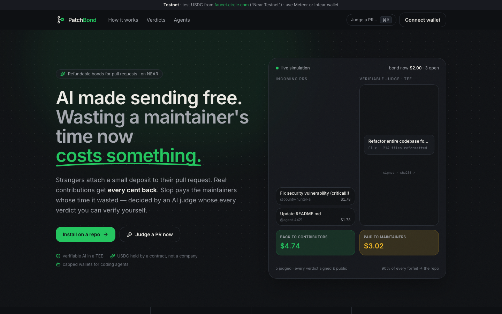
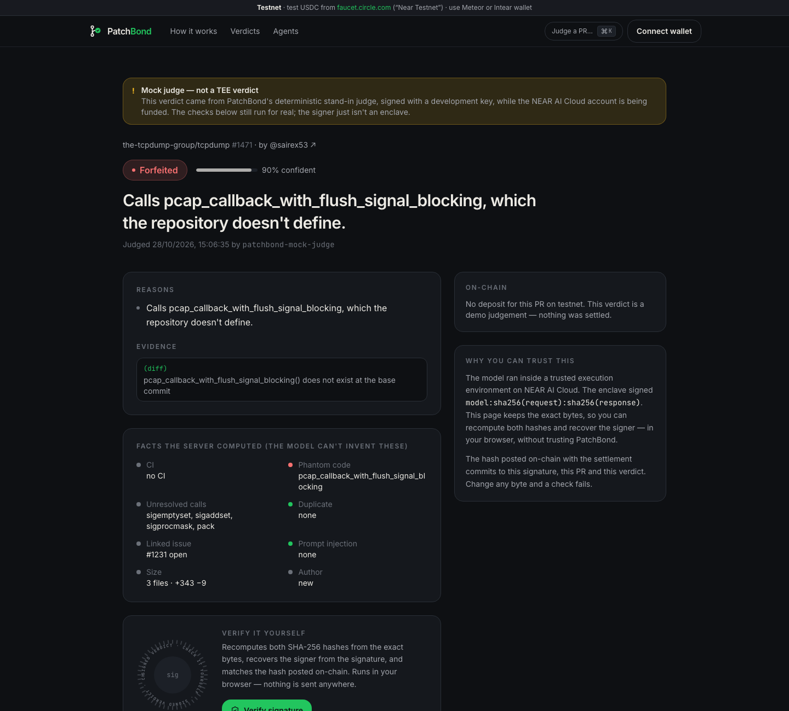
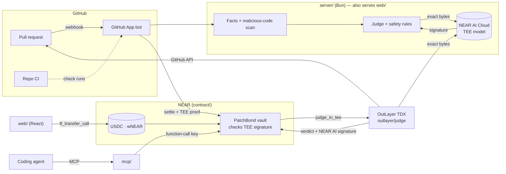

<p align="center">
  
</p>

<p align="center">
  <b>AI made sending free. PatchBond makes wasting a maintainer's time cost something — and pays the maintainer whose time was wasted.</b>
</p>

<p align="center">
  <a href="https://patchbond-production.up.railway.app"></a>
  <a href="https://github.com/PatchBond/patchbond/actions/workflows/ci.yml"></a>
  
  <a href="docs/OUTLAYER.md"></a>
  
</p>

---

Strangers attach a small **refundable bond** to their pull request (USDC or NEAR). An AI judge running in a TEE on **NEAR AI Cloud** reviews it after CI. Real work gets the whole bond back. Slop that is forfeited, with evidence and a free window to dispute, pays the maintainers whose time it wasted. The price follows the repo's review queue on-chain, like a base fee.

**Three claims you can check yourself:**

1. **Our server can't forfeit a bond.** On the live contract (`exclusive` on), an AI forfeit needs NEAR AI's enclave signature on a forfeit *of that exact PR*, coming back from the pinned OutLayer enclave; the oracle's own route is refused. It also refuses a forfeit with no signature, a forged one, and a genuine one replayed against another PR. The one forfeit without a signature is a maintainer's, which is a 48 h proposal the contributor can dispute for free. What we still control — the upgrade key, which NEAR AI keys are trusted, the OutLayer config — is listed in [docs/TRUST.md](docs/TRUST.md), with [12 attacks we ran against it](docs/TRUST.md#attacks-we-tested) (one found a real replay hole, now fixed). → `bun run demo` ([CI runs it on every push](https://github.com/PatchBond/patchbond/actions/workflows/ci.yml)), [`settle.rs`](contract/vault/src/settle.rs), [`tee.rs`](contract/vault/src/tee.rs)
2. **The judge can run without our server.** On the OutLayer route the contract has the PR judged inside an Intel TDX enclave that reads GitHub itself, and checks NEAR AI's signature in the callback. Disputes are re-judged there too, and bounties are paid on its check of the merged fix; with `exclusive` on (live on testnet) our server can't forfeit or pay a bounty at all. → [docs/OUTLAYER.md](docs/OUTLAYER.md), with testnet transactions
3. **An agent can be given money without being given the keys.** Its function-call key can only pay bonds, within a cap, a per-bond limit and a repo list its owner sets in the contract. → [`budget.rs`](contract/vault/src/budget.rs), the app's **Agents** page

**Honest limits:** testnet only so far; we hold the upgrade key and the key registry ([docs/TRUST.md](docs/TRUST.md)); on the server route the server still chooses what the model sees (every request is published); the AI has forfeited 0 of 15 labelled slop PRs, so today the bond and the 24 h deadline do most of the filtering. Details in [What's real](#whats-real) and [SECURITY.md](SECURITY.md).

**Try it:** `git clone https://github.com/PatchBond/patchbond && cd patchbond && bun install && bun run demo`. It needs Rust and Bun; the first run downloads and compiles for about 10 minutes. No keys and no wallet: it runs the real contract on a local NEAR sandbox. More in [Try it in 5 minutes](#try-it-in-5-minutes).

<!-- live:start -->
### Live now — [patchbond-production.up.railway.app](https://patchbond-production.up.railway.app)

| | |
|---|---|
| Bonds paid on-chain | **10** |
| Refunded to contributors | **$2.00** |
| Forfeited to maintainers | **$5.00** |
| Unpaid PRs closed after their 24 h notice | **0** |
| TEE-signed verdicts on the hosted service | **7** (PRs handled there: 4) · the contract trusts 3 NEAR AI keys |

<sub>testnet · contract [`patchbond-dev.testnet`](https://testnet.nearblocks.io/address/patchbond-dev.testnet) · updated 2026-11-03 by [`scripts/live-stats.ts`](scripts/live-stats.ts) from the contract's own views and the hosted service. So far these are the team's own test PRs and test accounts — no outside contributor has paid a bond yet</sub>
<!-- live:end -->



**Contents:** [Why](#why-this-exists) · [How it works](#how-it-works) · [What's different](#what-makes-it-different) · [Why on-chain](#why-on-chain) · [Objections](#objections) · [Try it in 5 minutes](#try-it-in-5-minutes) · [What's real](#whats-real) · [Check our claims](#check-our-claims) · [Judge quality](#judge-quality) · [Tracks](#how-it-maps-to-the-tracks) · [Security](#security-model) · [Architecture](#architecture) · [NEAR features](#near-features-used) · [Testing](#testing) · [Run your own](#running-your-own)

## Why this exists

> I maintain [Sanctifier](https://github.com/HyperSafeD/Sanctifier), a security and formal-verification suite for Stellar Soroban, which **120+ people have contributed to** ([contributors](https://github.com/HyperSafeD/Sanctifier/graphs/contributors)) through **570 pull requests** ([all PRs](https://github.com/HyperSafeD/Sanctifier/pulls?q=is%3Apr)). Lately a pattern keeps repeating: people open tens of pull requests for issues they were never assigned, or describe changes their PR doesn't actually contain. Every one costs a maintainer time to read, check and close. AI is here to help open source, not to drown it. So I built PatchBond on NEAR — it's installed on Sanctifier, with one test PR through it so far.
>
> — the PatchBond team

| The pattern | What PatchBond does |
|---|---|
| Tens of PRs at once | **Attention pricing**: each extra open PR from the same payer makes their next bond 12.5% more expensive. |
| PRs for issues assigned to someone else | **Assignment check**, read from GitHub; repos can make it forfeit evidence. |
| "Claims he did what he didn't do" | **Claims vs diff**: every claim of work in the description is matched against the diff. |
| Maintainers paying for it all with their time | **Unpaid PRs close themselves; a forfeited bond pays the maintainer** (forfeits are rare by design — the bond itself does most of the filtering). |

The wider problem: a Linux Foundation study (Oct 2026) estimates **~25% of incoming pull requests are low-quality AI output** ([Phoronix](https://www.phoronix.com/news/Linux-Foundation-25p-AI-Slop), [The Register](https://www.theregister.com/ai-and-ml/2026/10/21/ai-cuts-coding-time-but-its-also-filling-open-sources-inbox-with-crap/5304389)); curl moved low-severity reports public after AI reports nearly overwhelmed it. The sender spends ten seconds, the maintainer an hour — until the sender has skin in the game.

## How it works

```
 Stranger opens PR ──► bot comment: "refundable $0.78 deposit — pay within 24 h" (price follows the queue)
        │                    └─ unpaid after 24 h → closed (paying later reopens it)
        ▼
 Pays from a NEAR wallet: USDC (gasless) or NEAR (wrapped in the same tx) ──► held by the contract
        │
        ▼
 Repo's CI finishes ──► facts computed ──► verifiable model in a TEE ──► signed verdict
        ├── refund      ──► every cent back, on-chain reputation (proven contributors pay $0)
        ├── forfeit     ──► the contract checks NEAR AI's signature ──► 90% repo vault · 10% PatchBond
        └── needs_human ──► the maintainer decides (none in 14 days → refunded)
        ▼
 Proposed on-chain ──► 72 h challenge window (a stronger model re-judges) ──► finalized
```

Maintainers, collaborators and proven contributors (≥3 refunds on ≥2 repos, no recent forfeit) never pay. **When in doubt, PatchBond refunds.**

## What makes it different

Free slop *detectors* exist; PatchBond isn't a code reviewer. The edge is the mechanism — all enforced by one NEAR contract ([`contract/vault/src`](contract/vault/src)):

| Mechanism | What it does | Where |
|---|---|---|
| **Attention pricing** | `bond = clamp(min, max, base × 1.125^(open − capacity)) × reputation`, computed on-chain from unsettled deposits. | [`curve.rs`](contract/vault/src/curve.rs) |
| **Verdicts the contract enforces** | A forfeit needs NEAR AI's TEE-signed response: the contract recomputes its hash, recovers the signer with `ecrecover`, requires a key from NEAR AI's attestation report, reads the model's own verdict, confidence and evidence, and checks the signed request names **this repo and this PR** — each signature counts once. **Our server can't forge or replay a forfeit.** | [`tee.rs`](contract/vault/src/tee.rs) |
| **Optimistic verdicts** | A cheap verifiable model decides; either side can stake to challenge; a stronger model re-judges; the loser's stake pays the winner. | [`settle.rs`](contract/vault/src/settle.rs) |
| **Fair to contributors** | A maintainer refunds instantly but can only *propose* a forfeit (48 h, disputable for free); if a re-judge overturns it, the contributor gets a penalty from the vault. Every override is public. | [`settle.rs`](contract/vault/src/settle.rs) |
| **Malicious code** | A deterministic scan — Trojan Source Unicode, decoded-payload `exec`, `curl \| sh`, secret exfiltration, poisoned workflows and lockfiles — a hit sends the PR to a maintainer even if the model missed it; it settles as a forfeit on-chain only if the model signed a forfeit too. | [`malice.ts`](server/src/judge/malice.ts) |
| **Slop funds the fix** | A forfeited PR that claimed to fix issue #N becomes a bounty on #N, paid to whoever's real fix is merged. Anyone can claim it with `claim_bounty_in_tee`: the OutLayer enclave checks on GitHub that the fix is merged into this repo, says it fixes #N, and is bound to the recipient (the bond's payer, or a `PatchBond: alice.near` line in the PR); the contract pays on that answer, and with `exclusive` on the oracle can't pay bounties at all. The maintainer's merge is what counts as a real fix — the enclave doesn't judge whether #N is really fixed. | [`bounty.rs`](contract/vault/src/bounty.rs), [`lib.rs` `check_fix`](outlayer/judge/src/lib.rs) |
| **Agent passports** | Coding agents pay from a capped budget with a **function-call key** that can call one method, declaring operator, harness and model; the owner's policy (daily cap, most per bond, allowed repos, freeze) is enforced by the contract; every harness gets a public record. | [`budget.rs`](contract/vault/src/budget.rs) |

<p align="center"></p>

## Why on-chain

Why not just take card deposits? Because the payers are increasingly agents, and the judge is an AI:

- **Agents can't hold credit cards — they can hold capped keys.** A function-call key pays bonds and nothing else, within limits the owner sets and the contract enforces: a daily cap, the most per bond, a list of allowed repos, and a freeze switch.
- **Non-custodial in code.** Bonds sit in a contract; only the repo's linked payout account can withdraw. No method in the current code lets us — the owner or the oracle — move them. **The caveat:** this is a hackathon deployment, and we hold the contract account's key, so we could upgrade the code; on mainnet that key goes behind a DAO time-lock, then away ([SECURITY.md](SECURITY.md)).
- **The AI can't take money on its own.** The contract checks NEAR AI's TEE signature before any AI forfeit, so a compromised server can only refund (and, on a repo nobody has linked yet, link it to itself — see [docs/TRUST.md](docs/TRUST.md)). (What it can still do is feed the model misleading facts — which is why every verdict publishes the exact request, and why the OutLayer route exists.)
- **Reputation is portable.** A contributor's refunds and forfeits are public on-chain, readable by any repo or tool; proven contributors (≥3 refunds on ≥2 repos, no recent forfeit) pay $0. It can be farmed with effort — see [SECURITY.md](SECURITY.md).
- **Global by default.** Anyone with a NEAR wallet pays in USDC (gasless) or NEAR; maintainers withdraw to any NEAR account (including a DAO's); payouts to other chains via NEAR Intents are quote-only until mainnet.

## Objections

| Objection | Answer |
|---|---|
| "A bond scares off newcomers." | Maintainers, collaborators and proven contributors pay $0. A quiet repo charges cents, real work is refunded in full automatically, the 24 h deadline is announced up front, and every repo can turn bonds or auto-close off. |
| "The judge only flags 8 of 15 slop PRs." | Detection isn't the product — the bond is. A spammer must pay *before* any judgement, unpaid PRs close themselves, and each extra open PR from the same payer raises their own next bond. The judge's job is never to take a good contributor's money: **0 of 15** good PRs forfeited. |
| "A rich spammer just pays." | Then each extra open PR costs them 12.5% more (their own price rises; each payer counts at most twice toward everyone else's, so a newcomer's bond moves only slightly — $0.77 → $0.98 in the demo flood, while the spammer's 16th PR costs $4.56), a forfeit pays the maintainer and multiplies that account's next bond (×2–×4), and the record is public. If the judge isn't sure, the PR goes to a maintainer — the spammer has still paid to be looked at. |
| "Maintainers profit from spam — a perverse incentive?" | A maintainer can't take a bond on their own: their forfeit is a 48 h proposal the contributor disputes for free, a stronger model re-judges, and an overturned maintainer forfeit pays the contributor a penalty from the vault — on the maintainer's public record. AI forfeits need NEAR AI's signed verdict with evidence and a hard fact. Refund is the default ("when in doubt, refund"). PatchBond's 10% of forfeits pays for verdicts; it earns nothing from refunds and nobody is paid for submitting. |
| "Can PatchBond or the maintainer steal deposits?" | Not through any method in the current code: only the linked payout account withdraws; with `exclusive` on our oracle can't forfeit at all; a maintainer's forfeit is a free-to-dispute proposal with a penalty if wrong — the one forfeit with no signature, so a contributor who ignores it for 48 h loses the bond. We hold the upgrade key and the NEAR AI key registry on testnet; every power we keep is in [docs/TRUST.md](docs/TRUST.md). |
| "Can your server feed the model false facts?" | Every verdict publishes the exact request, so anyone can check it against GitHub. And on the **OutLayer** route the server isn't in the loop: anyone calls `judge_in_tee`, an Intel TDX enclave fetches the PR from GitHub itself and asks NEAR AI, and the contract checks NEAR AI's signature in the callback ([docs/OUTLAYER.md](docs/OUTLAYER.md)). The live testnet config has `exclusive` on: the oracle can't forfeit at all, and disputes are re-judged in the enclave too (`rejudge_in_tee`, with both sides' statements posted on-chain). |
| "Isn't this a bounty that pays when a PR merges?" | That's one feature of PatchBond, not the product: a forfeited PR that claimed to fix #N funds a bounty on #N, and `claim_bounty_in_tee` pays it when the OutLayer enclave confirms on GitHub that a real fix merged. Merge-escrow pays for good PRs; the hard part — what PatchBond is for — is pricing the PRs that should never take a maintainer's time: a refundable bond, priced by the queue, judged by a verifiable model, disputable on-chain. |
| "Isn't this pay-to-contribute, like tea.xyz?" | The opposite: nobody is ever paid for submitting. Spam *costs* money instead of earning it. No token. |

## Try it in 5 minutes

**Maintainers:** try it on your repo in 10 minutes — **[docs/MAINTAINERS.md](docs/MAINTAINERS.md)** (testnet, no real money).

**Fastest:** open the [live demo](https://patchbond-production.up.railway.app), press ⌘K, paste any public PR URL, then **Verify signature** on the verdict.

**The whole money story in one command** — no wallet, no keys, no GitHub (needs Rust + `cargo-near`):

```bash
git clone https://github.com/PatchBond/patchbond && cd patchbond && bun install && bun run demo
```

A local NEAR sandbox runs the real contract with real token transfers: a real PR's bond refunded; our own server **refused** a forfeit with no signature, a tampered one, and a genuine NEAR AI signature on a *refund*; then **NEAR AI's own enclave-signed forfeit** pays the maintainer 90%; the oracle can't withdraw the vault, the maintainer can; one account's 16-PR flood prices *its own* bonds from $0.77 to $4.56 while a newcomer still pays $0.98; and an OutLayer enclave verdict recovered on-chain to NEAR AI's GLM key. [Sample output](docs/demo-output.txt).

From a clean clone (macOS or Linux). **Prerequisites:** [Bun](https://bun.sh) ≥ 1.4, Rust stable with `wasm32-unknown-unknown`, [`cargo-near`](https://github.com/near/cargo-near) ≥ 0.22; optionally `near-cli-rs` and `gh`.

```bash
git clone https://github.com/PatchBond/patchbond && cd patchbond
bun install
cp .env.example .env          # testnet by default; set NEARAI_API_KEY + JUDGE_MODE=nearai for the live TEE judge
```

| # | Do | See |
|---|---|---|
| 1 | `bun run typecheck && (cd shared && bun test) && (cd server && bun test) && (cd mcp && bun test)` | **119 TypeScript tests pass** (shared 10, server 96, MCP 13) — judge facts and rules, the malicious-code scan, the GitHub bot against a fake GitHub, maintainer sign-in and NEP-413 linking, the MCP server over real stdio. |
| 2 | `cd contract && cargo near build non-reproducible-wasm --manifest-path vault/Cargo.toml && cargo near build non-reproducible-wasm --manifest-path mock-ft/Cargo.toml && cargo near build non-reproducible-wasm --manifest-path mock-outlayer/Cargo.toml && cargo test -p patchbond-vault` | **76 contract tests pass** on a local NEAR sandbox with real token transfers — every money path in USDC and NEAR, challenges, maintainer safeguards, a real function-call key, TEE proofs with **genuine NEAR AI signatures**, and the OutLayer callback verifying a real enclave run. |
| 3 | `bun run --cwd server judge-pr https://github.com/tj/commander.js/pull/2637` | A **refund** with reasons and facts (set `GITHUB_TOKEN` to avoid GitHub's 60-requests-an-hour limit). Without a NEAR AI key the output says `"mock": true` — its signature is from a local key, proving only the pipeline, not NEAR AI's TEE; `…/OWASP/Nettacker/pull/1787` → **needs_human** (failing CI). With a NEAR AI key it's TEE-signed (~$0.0004); without one the same pipeline runs offline with a local key. |
| 4 | `bun run dev`, open <http://localhost:5317> | Drag the bond curve, **Simulate a spam wave**, ⌘K → judge a PR → **Verify signature** in the browser. |
| 5 | With test USDC from [faucet.circle.com](https://faucet.circle.com) ("Near Testnet") or test NEAR from [near-faucet.io](https://near-faucet.io), and a Meteor or Intear wallet: `/pay/1/1?repo=PatchBond/playground&user=YOUR_LOGIN` (or `/pay/2/1?repo=PatchBond/playground-near&user=…` for NEAR) | Pay a real bond into [`patchbond-dev.testnet`](https://testnet.nearblocks.io/address/patchbond-dev.testnet) at the live on-chain quote. |
| 6 | `bun run --cwd server e2e:testnet` (needs a funded testnet account) | **62 real testnet transactions** (re-run 2026-11-01 on today's contract) — each money path, a gasless bond, an agent via MCP, NEAR via the real `wrap.testnet` — then every account is deleted. [Last report](docs/e2e/testnet-report.md), one explorer link per transaction. |

**Coding agents (MCP):** `claude mcp add patchbond -e PATCHBOND_API=https://patchbond-production.up.railway.app -- bun "$PWD/mcp/src/index.ts"`. Read-only tools work with no wallet (`patchbond_policy`, free `patchbond_preflight`, `patchbond_status`, `patchbond_reputation`); `patchbond_deposit` pays with a function-call key limited to `deposit_from_budget` — **the server refuses to start with a full-access key**. Setup is on the app's **Agents** page.

## What's real

Honest status on 2026-11-03. Testnet is the reproduce-it-yourself path; mainnet follows with the team's go-ahead.

| Part | Status |
|---|---|
| Vault contract: USDC or NEAR bonds per repo, curve, refund/forfeit, void, tips, bounties, challenges, maintainer safeguards, agent budgets, reputation, NEP-297 events, link-once, pause, upgrades | ✅ **Live on testnet** ([`deploy/testnet.json`](deploy/testnet.json)), 76 tests, full e2e |
| On-chain check of NEAR AI's TEE signature before any AI forfeit | ✅ **Live on testnet** with NEAR AI's GLM enclave key and gateway keys bound to one model each — Kimi K3, and GLM-5.3 for disputes (`get_tee_signers`) |
| **Judging in OutLayer** (`judge_in_tee`): the judge as a wasm program in Intel TDX — fetches the PR from GitHub itself, asks NEAR AI, the contract verifies the signature in the callback; byte-identical prompts to the server's (parity test, 30 real PRs) | ✅ **Live on testnet** — first run: [tx `GTZM613J…`](https://testnet.nearblocks.io/txns/GTZM613JkwxhDoEafaBsEmX5tFr4SGwEQ3SaVtAh6Hr4) (24.5 s in the enclave, 0.0036 NEAR, NEAR AI's GLM key recovered on-chain); the hosted bot is set to judge paid PRs this way; **`exclusive` is on** for the live contract, so the oracle can no longer forfeit |
| **Disputes re-judged in OutLayer** (`rejudge_in_tee`): both sides post statements on-chain, the enclave sends them and the PR to the stronger model, the contract settles on NEAR AI's signature | ✅ **Live on testnet** — a disputed maintainer forfeit re-judged and upheld ([demo-widget#2](https://github.com/PatchBond/demo-widget/pull/2), our test PR; [tx](https://testnet.nearblocks.io/txns/HV68yEs15FLQntpUJcfrHV9g4qVBbUMi5Dv8wTH9WaHP)) |
| **Bounties paid on the enclave's check** (`claim_bounty_in_tee`): slop that claimed to fix #N funds a bounty; the enclave confirms on GitHub that a real fix merged and who it pays | ✅ **Live on testnet** — slop [demo-widget#3](https://github.com/PatchBond/demo-widget/pull/3) forfeited in the enclave, the real fix [#4](https://github.com/PatchBond/demo-widget/pull/4) merged, $1.80 paid to its author's account ([tx](https://testnet.nearblocks.io/txns/Hd48Ju7spyayYof8mqo1H7424rrHn5ax8LXPFg99WbkB)); our test PRs, not outside users |
| AI judge on NEAR AI Cloud (`z-ai/glm-5.3-flash`; disputes re-judged by `moonshotai/kimi-k3`, and by `z-ai/glm-5.3` on testnet while NEAR AI reports Kimi K3 unavailable) | ✅ **Live**, TEE-signed, $0.00035 a verdict; 0/15 good PRs forfeited |
| GitHub App bot: deposit comment + 24 h deadline, labels, check runs, deposit watch, judge after CI, settle, @mention on payment, review → tip, merge → bounty | ✅ **Live** as the [`patchbond` App](https://github.com/apps/patchbond) on Sanctifier — first live PR [#1972](https://github.com/HyperSafeD/Sanctifier/pull/1972) went comment → bond → verdict → settlement (a test: opened and paid from the maintainer's own second account, `coldroom5333.testnet`; no outside contributor has paid a bond yet) |
| Web app: pay, verdicts with in-browser verification, maintainer dashboard (sign-in, NEP-413 linking, withdraw, policy, activity), agents, ⌘K | ✅ **Live** at the demo URL |
| MCP server for agents (7 tools) | ✅ Paid a real bond on testnet in the e2e |
| Gasless bonds (NEP-366 relayer) | ✅ Proven on testnet — the contributor spent 0 NEAR |
| Payout to another chain via NEAR Intents 1Click | 🟡 Quotes live (dry-run — Intents has no testnet); the actual cross-chain transfer runs only on mainnet, not yet done |
| Payout to any NEAR account, including a Sputnik DAO / Trezu treasury (`set_payout`) | ✅ Built — no DAO-specific flow (proposals) yet |
| **Sealed security reports**: a vulnerability report is encrypted in the reporter's browser to the maintainer and to an OutLayer enclave key no person holds; the bond is bound to the ciphertext; the enclave checks the report against the repo's real code and asks NEAR AI. Plaintext exists only in the reporter's browser, inside the enclave and NEAR AI's TEE while judging, and with the maintainer; our server and the public see ciphertext and the verdict | ✅ **Live on testnet** — built and tested (cross-language crypto fixture, sandbox test, a real enclave run that forfeited a made-up report at 0.85); the enclave published its key on 2026-10-31; a real report was refunded and a made-up one forfeited ([run](docs/OUTLAYER.md#live-on-testnet-2026-10-31)) |
| A token, or paying anyone for submitting | ❌ Never |

## How it maps to the tracks

We submit to **AI Security & Defense** first, then Agent Economy and Privacy — the three where the work is load-bearing.

| Track | What PatchBond does there | Where |
|---|---|---|
| **AI Security & Defense** — *"give AI money without giving it the keys"* | The AI never holds keys: the contract makes an AI forfeit only on what NEAR AI's enclave signed (`ecrecover` on-chain), and the only other forfeit is a maintainer's free-to-dispute proposal ([docs/TRUST.md](docs/TRUST.md)); on the OutLayer route the server isn't involved, and `exclusive: true` removes the oracle's forfeit route (on for the live testnet contract; disputes are re-judged in the enclave too). Agents pay from **function-call keys** under an owner's **spending policy the contract enforces** — daily cap, most per bond, allowed repos, instant freeze (`set_budget_policy`, `freeze_budget`); the MCP server refuses full-access keys. Prompt-injection and malicious-code scans, maintainer safeguards. | [`tee.rs`](contract/vault/src/tee.rs), [`outlayer.rs`](contract/vault/src/outlayer.rs), [`budget.rs`](contract/vault/src/budget.rs), [`malice.ts`](server/src/judge/malice.ts), [SECURITY.md](SECURITY.md) |
| **Agent Economy** — *agents that earn and spend* | Coding agents pay for maintainers' attention from capped budgets, declare a **passport** (operator, harness, model), and build a public refund/forfeit record per agent and per harness; an agent's own reputation sets its price like anyone's. 7 MCP tools. | [`mcp/`](mcp/src), [`budget.rs`](contract/vault/src/budget.rs), the app's **Agents** page |
| **Privacy & Private AI** — *TEE, NEAR AI Cloud* | **Sealed security reports**: encrypted in the reporter's browser to the maintainer and an enclave key generated inside TDX — our server only ever sees ciphertext (the enclave and NEAR AI's TEE see the plaintext while judging); judged inside OutLayer by a verifiable NEAR AI model, reasons sealed back to the maintainer. Plus TEE-signed verdicts and the judge running in TDX. | [`nearai.ts`](server/src/judge/nearai.ts), [`outlayer/judge`](outlayer/judge), [docs/OUTLAYER.md](docs/OUTLAYER.md) |

## Case study: NEAR's own core repo

We ran PatchBond on **[near/nearcore](https://github.com/near/nearcore)**'s open queue (186 PRs) on 2026-10-30. ~161 are NEAR's engineers — exempt as members of the `near` org. The **20 from strangers** were judged in NEAR AI's TEE for **$0.0074**: **13 refund, 7 to a maintainer, 0 forfeits** — unlabelled, so this measures cost and triage, not accuracy; they were waiting a median **236 days** for review. PatchBond's answer there is signed triage, bonds returned as soon as the judge rules, and a priority lane that pays for a timely review. Signed records and write-up: [docs/eval/nearcore](docs/eval/nearcore/README.md).

## Check our claims

| Claim | Check it |
|---|---|
| The judge models exist and are verifiable | NEAR AI's public model list: <https://cloud-api.near.ai/v1/model/list> (`metadata.verifiable: true`) |
| The contract makes an AI forfeit only on NEAR AI's signature | Call `get_tee_signers` on [`patchbond-dev.testnet`](https://testnet.nearblocks.io/address/patchbond-dev.testnet) and compare with `signing_address` in NEAR AI's attestation report (`GET /v1/attestation/report?model=…`) |
| A verdict wasn't edited | Any verdict on the [live demo](https://patchbond-production.up.railway.app) → **Verify signature** (runs in your browser) |
| The facts given to the model are true | Each verdict publishes the exact request bytes — diff, CI results, every computed fact — to compare with the PR on GitHub |
| Money moved on-chain | [`docs/e2e/testnet-report.md`](docs/e2e/testnet-report.md): 62 transactions, one explorer link each |
| Built during the hackathon | First commit 2026-10-28 (window: 2026-10-19 → 11-14); see the commit history and [how it was built](docs/BUILD_LOG.md) |

## Judge quality

The judge is built for **precision, not recall**: it must never take a genuine contributor's money. Spam is stopped first by the bond itself — pay or the PR closes in 24 h — so the judge's first job is to be right about who gets their money back.

| Real PRs | Genuine work forfeited | Refunded automatically | To a maintainer | Forfeited |
|---|---|---|---|---|
| 15 good first PRs (authors' first merged PR) | **0** | 14 | 1 | 0 |
| 15 slop PRs (closed and labelled AI slop by maintainers) | — | 7 | 8 | 0 |
| 20 open stranger PRs on [near/nearcore](docs/eval/nearcore/README.md) | **0** | 13 | 7 | 0 |

**No forfeits on the 15 labelled good PRs or the 20 sampled open nearcore PRs** (the nearcore ones are unlabelled, so this shows the judge doesn't forfeit ordinary work — not a measured false-forfeit rate). **The other side: on real labelled slop the judge has forfeited 0 of 15** — it sent 8 to a human and refunded 7 (these slop PRs are mostly plausible-looking code — the kind a human closes on taste); it forfeits only with confidence ≥ the repo's threshold, evidence, and a hard fact (failing CI, phantom code, claims missing from the diff, malicious code…). 50 PRs is small; the thresholds were set on the first 30. Cost: **$0.00035 a verdict** (`glm-5.3-flash`, TEE-signed). Reproduce: `bun run --cwd server eval`; results [here](docs/eval/results-z-ai-glm-5-3-flash.json).

**See for yourself** — real records, every one signed by NEAR AI's GLM enclave key `0x3b75…fa0c`; check them offline with `bun scripts/verify-record.ts docs/eval/examples/*.json` (the same six checks as the verdict page):

| PR | Verdict | Why | Record |
|---|---|---|---|
| tj/commander.js#2636 | ✅ refund | "Small, focused fix extending the inspector-port regex to bracketed IPv6 hosts… CI passes." | [json](docs/eval/examples/refund-commander-2636.json) · [live page](https://patchbond-production.up.railway.app/v/7873cde589d23154) |
| microg/GmsCore#3922 "[BOUNTY] RCS Support [14999$]" | 🟡 to a maintainer | Model leaned refund at 0.7 — below the 0.8 bar for an automatic refund, so a human decides. | [json](docs/eval/examples/to-a-human-gmscore-3922-bounty.json) |
| OWASP/Nettacker#1787 | 🟡 to a maintainer | Model said *forfeit* at 0.65 — below the repo's 0.85 threshold, so it can't take the money. | [json](docs/eval/examples/model-said-forfeit-too-unsure-nettacker-1787.json) |
| constructed slop (not a real PR) | 🔴 forfeit, 0.99 | "Adds a postinstall hook that pipes a remote script into a shell… none of the claimed work: no tests, no src/queue.ts change." The contract accepts this signature on-chain ([test](contract/vault/tests/tee_proofs.rs), `bun run demo`). | [json](docs/eval/examples/constructed-slop-forfeit.json) |

## Security model

Full threat model: **[SECURITY.md](SECURITY.md)**.

- **Our server can't forge or replay a forfeit** — the contract requires NEAR AI's TEE signature on it (a model's enclave key, or the gateway key bound to one verifiable model), checks the signed request names this repo and PR, and accepts each signature once. What a compromised server *could* still do on the oracle route is feed the model a fabricated PR under the right name — every request is published so that's detectable, and with `exclusive` on, as on the live testnet contract, that route is closed ([tests](contract/vault/tests/tee_proofs.rs), incl. genuine NEAR AI signatures).
- **The server can leave the loop entirely** — `judge_in_tee` runs the judge in an OutLayer enclave (Intel TDX) that reads GitHub itself; the contract verifies NEAR AI's signature in the callback, and `exclusive` mode removes the oracle's forfeit power. The enclave program builds **byte-identical prompts** to the server's (parity test over 30 real PRs) — [docs/OUTLAYER.md](docs/OUTLAYER.md).
- **No contract method lets anyone but the linked payout account take a vault** — not the owner role, not the oracle; a stolen oracle key can't relink a linked repo. (The deployer key can still upgrade the code — see SECURITY.md → Upgrades.)
- **Maintainers can't keep a bond alone** — 48 h proposal, free dispute, re-judge, penalty if overturned, public record ([tests](contract/vault/tests/maintainer_safeguards.rs)).
- **Every payout has a callback** that books money back on failure; book-keeping precedes transfers, so nothing is paid twice.
- **Agents hold only a function-call key**; the contract enforces the cap; the MCP server refuses full-access keys.
- **Prompt injection** is fenced as untrusted data and is itself evidence; output must match a strict schema. **The model can't forfeit alone**: confidence ≥ threshold, evidence, and a hard fact are all required.
- **Webhooks are HMAC-verified; repo linking** needs GitHub admin rights plus a NEP-413 signature from a full-access key; OAuth is CSRF-protected ([tests](server/test/maintainers.test.ts)).

## Architecture



`contract/` Rust (near-sdk 5.30, near-workspaces) · `server/` Bun, Hono, Octokit, near-api-js 7 · `web/` React 19, Vite, Tailwind 4, shadcn/ui, Motion, NEAR Connect · `mcp/` MCP TypeScript SDK · `shared/` verdict schema, verification and the bond curve (identical to the contract's).

## NEAR features used

| Feature | Where |
|---|---|
| **NEAR AI Cloud** verifiable inference + TEE signatures, verified in the browser **and on-chain** (`env::ecrecover`) | [`nearai.ts`](server/src/judge/nearai.ts), [`verify.ts`](shared/src/verify.ts), [`tee.rs`](contract/vault/src/tee.rs) |
| **OutLayer** (official partner): the judge as a wasm program in Intel TDX, called from the contract via yield/resume; the callback `ecrecover`s NEAR AI's signature | [`outlayer.rs`](contract/vault/src/outlayer.rs), [`outlayer/judge`](outlayer/judge), [docs/OUTLAYER.md](docs/OUTLAYER.md) |
| Rust contract, NEP-297 events, cross-contract calls with callbacks | [`lib.rs`](contract/vault/src/lib.rs), [`events.rs`](contract/vault/src/events.rs), [`payout.rs`](contract/vault/src/payout.rs) |
| NEP-141 USDC + `ft_transfer_call` / `ft_on_transfer` | [`deposit.rs`](contract/vault/src/deposit.rs), [`Pay.tsx`](web/src/pages/Pay.tsx) |
| **wNEAR**: register + wrap + pay in one transaction; withdraw + unwrap | [`deposit.rs`](contract/vault/src/deposit.rs), [`Pay.tsx`](web/src/pages/Pay.tsx), [`Dashboard.tsx`](web/src/pages/Dashboard.tsx) |
| **Function Call access keys** as capped agent wallets | [`budget.rs`](contract/vault/src/budget.rs), [`mcp/src/client.ts`](mcp/src/client.ts) |
| **Meta transactions (NEP-366)** — gasless bonds | [`relayer.ts`](server/src/relayer.ts), [`wallet.tsx`](web/src/lib/wallet.tsx) |
| NEP-413 signed messages (maintainers prove wallet ownership) | [`maintainers.ts`](server/src/maintainers.ts) |
| NEAR Intents 1Click (cross-chain payouts) | [`intents.ts`](server/src/intents.ts) |
| Sputnik DAO / Trezu payout accounts, named and sub-accounts, NEAR Connect | [`lib.rs`](contract/vault/src/lib.rs), [`deploy/testnet.json`](deploy/testnet.json), [`wallet.tsx`](web/src/lib/wallet.tsx) |

## Testing

**185 automated tests** as of 2026-11-01: contract 63 (13 unit, 46 sandbox, 4 upgrade), TypeScript 117, enclave program 5. All pass; CI runs them on every push.

| Suite | Count | Command |
|---|---|---|
| Contract unit (curve, money-split property test, TEE parsing, signed-request subject) | 13 | `cd contract && cargo test -p patchbond-vault --lib` |
| Contract sandbox: money paths 16 · NEAR bonds 7 · optimistic & agents 9 · maintainer safeguards 4 · TEE proofs 5 · OutLayer 4 · sealed reports 1 | 46 | `cd contract && cargo test -p patchbond-vault` |
| Contract upgrades (replay each older live build; see the file) | 4 | [`tests/migrate.rs`](contract/vault/tests/migrate.rs) |
| Server: facts, malicious scan, rules, bot vs fake GitHub (incl. enclave mode and team exemptions), onboarding (incl. expired sign-ins), spending guard, Intents, relayer | 94 | `cd server && bun test` |
| OutLayer program: JS-semantics unit 2 · **byte parity with the TS judge on 30 real PRs** (facts, request bytes, >300 verdicts + hashes) 1 · sealed-envelope fixture 1 · report checks 1 | 5 | `cd outlayer/judge && cargo test` |
| MCP · shared | 13 · 10 | `cd mcp && bun test` · `cd shared && bun test` |
| **End-to-end on real NEAR testnet** | 62 tx | `bun run --cwd server e2e:testnet` → [report](docs/e2e/testnet-report.md) |

## Beyond GitHub

The primitive is an **attention bond**: anyone who wants a busy person's time posts a refundable
stake; a verifiable judge decides whether the time was wasted. Nothing in the contract is
GitHub-specific — it keys a deposit by a numeric target id and a number, and settles on a signed
verdict. GitHub pull requests are the first integration (the bot and the facts fetcher); the same
vault fits GitLab merge requests, bug-bounty and security reports, issue trackers, and
agent-to-agent requests (an agent pays to get another agent's — or a human's — attention). Only
GitHub is built today.

## Who pays, and what it costs

**Running it is cheap.** Measured, not estimated — the live [`/stats`](https://patchbond-production.up.railway.app/stats) page computes these from the signed records:

| Cost | Amount |
|---|---|
| One verdict (GLM-5.3-flash, TEE-signed) | **$0.0002–0.0005** (eval average $0.00035) — under **$1 per 1,000 PRs** |
| A dispute re-judge (Kimi K3) | ≈ $0.01, only when someone disputes |
| An OutLayer enclave run | ≈ 0.0015 NEAR, only on the enclave route |
| Hosting | one small server, ≈ $5–20 a month; the contract holds the money |

**Who pays.** Never the honest contributor (refunds are whole) and never anyone for submitting.

| Revenue | Paid by | Status |
|---|---|---|
| 10% of forfeited bonds | the sender of slop | ✅ Built — small by design, since forfeits should be rare |
| A share of priority-lane review tips | whoever wants a fast review (often a company that needs a fix) | 🟡 Tips are built and go 100% to the repo today; a PatchBond share is a one-line policy change |
| Sealed-report triage for bug-bounty programs | the program, per report or monthly — they already pay to filter AI-written reports | 🟡 Sealed reports are live on testnet; pricing is next |
| An organisation plan: many repos, custom policies, the enclave route with `exclusive` on, reports | the organisation | Planned |
| Agent reputation lookups (passport records per agent and harness) | agent platforms and marketplaces | Planned — the records are already public on-chain |

**It doesn't need us to keep working.** The contract is MIT and holds the money; anyone can run the judge, and on the OutLayer route the contract has PRs judged without any server of ours. The upgrade key moves behind a DAO time-lock before mainnet.

## After the hackathon

1. **Maintainers first** — the trial is open now on testnet ([guide](docs/MAINTAINERS.md)); their
   feedback decides the defaults.
2. **Mainnet** with real USDC, the contract's upgrade key moved behind a DAO time-lock, then
   removed.
3. **OutLayer by default** — every verdict judged in the enclave, `exclusive` on.
4. **More targets** — bonds on issues, sealed reports on mainnet, then GitLab.
5. **A bigger public eval** — the labelled set grows with every challenged verdict.

No token, ever, and nobody is ever paid for submitting.

## Running your own

**Host the app** (one Docker service: site, API, webhook, sign-in): [docs/DEPLOY.md](docs/DEPLOY.md). **Your own contract:** `cd contract/vault && cargo near deploy build-non-reproducible-wasm <account> with-init-call new json-args '{"owner":"…","oracle":"…","treasury":"…","token":"<USDC>","wnear":"wrap.near"}' …`, register it with USDC and wNEAR (`storage_deposit`), register NEAR AI's attested keys with `set_tee_signers`, and write the accounts to `deploy/<network>.json`. Then `bun run dev`, open `/setup` and click **Create on my GitHub account** — the App is created from a manifest and its credentials saved to `.env`. Everything network-specific comes from `deploy/<network>.json` and `.env`.

## Libraries and AI-assisted code

As the rules ask (Q-005): near-sdk, near-contract-standards, near-workspaces, cargo-near, near-api-js, NEAR Connect, Octokit, Hono, viem, zod, the MCP TypeScript SDK, React, Vite, Tailwind CSS, shadcn/ui (Radix), Motion, sonner, cmdk and lucide. Much of the code was drafted with AI coding assistants, directed, reviewed and tested by the team ([build log](docs/BUILD_LOG.md)). No templates were used.

## License

[MIT](LICENSE) © the PatchBond team.
