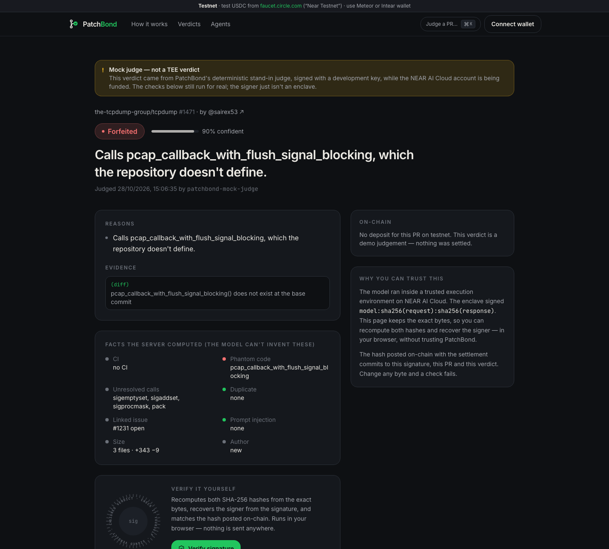

# How PatchBond is designed

The mechanisms, the reasoning behind them, and the objections we expect. For who can move money and what each guarantee rests on, see [TRUST.md](TRUST.md).

## What makes it different

Free slop *detectors* exist; PatchBond isn't a code reviewer. The edge is the mechanism — all enforced by one NEAR contract ([`contract/vault/src`](../contract/vault/src)):

| Mechanism | What it does | Where |
|---|---|---|
| **Attention pricing** | `bond = clamp(min, max, base × 1.125^(open − capacity)) × reputation`, computed on-chain from unsettled deposits. | [`curve.rs`](../contract/vault/src/curve.rs) |
| **Verdicts the contract enforces** | An AI forfeit needs a NEAR AI signature, recovered with `ecrecover` to a key from NEAR AI's attestation report, each one used once. On the oracle route (closed while `exclusive` is on) the contract also reads the verdict from the signed bytes and checks they name this repo and PR. On the enclave route it sees only hashes, so the verdict rests on OutLayer's attested worker ([details](TRUST.md#what-the-outlayer-callbacks-verify)). | [`tee.rs`](../contract/vault/src/tee.rs) |
| **Optimistic verdicts** | A cheap verifiable model decides; either side can stake to challenge; a stronger model re-judges; the loser's stake pays the winner. | [`settle.rs`](../contract/vault/src/settle.rs) |
| **Fair to contributors** | A maintainer refunds instantly but can only *propose* a forfeit (48 h, disputable for free); if a re-judge overturns it, the contributor gets a penalty from the vault. Every override is public. | [`settle.rs`](../contract/vault/src/settle.rs) |
| **Malicious code** | A deterministic scan — Trojan Source Unicode, decoded-payload `exec`, `curl \| sh`, secret exfiltration, poisoned workflows and lockfiles — a hit sends the PR to a maintainer even if the model missed it; it settles as a forfeit on-chain only if the model signed a forfeit too. | [`malice.ts`](../server/src/judge/malice.ts) |
| **Slop funds the fix** | A forfeited PR that claimed to fix issue #N becomes a bounty on #N, paid to whoever's real fix is merged. Anyone can claim it with `claim_bounty_in_tee`: the OutLayer enclave checks on GitHub that the fix is merged into this repo, says it fixes #N, and names the recipient on a line of its own, `PatchBond: alice.near`; the contract pays on that answer, and with `exclusive` on the oracle can't pay bounties at all. The maintainer's merge is what counts as a real fix — the enclave doesn't judge whether #N is really fixed. | [`bounty.rs`](../contract/vault/src/bounty.rs), [`lib.rs` `check_fix`](../outlayer/judge/src/lib.rs) |
| **Agent passports** | Coding agents pay from a capped budget with a **function-call key** that can call one method, declaring operator, harness and model; the owner's policy (daily cap, most per bond, allowed repos, freeze) is enforced by the contract; every harness gets a public record. | [`budget.rs`](../contract/vault/src/budget.rs) |

## Why on-chain

Why not just take card deposits? A card network could hold a deposit, but it couldn't give an agent a key that can only pay bonds, or let anyone check on their own how a bond was settled:

- **The limits on an agent live in the contract, not in the agent's tooling.** A function-call key pays bonds and nothing else, within limits the owner sets and the contract enforces: a daily cap, the most per bond, a list of allowed repos, and a freeze switch.
- **Non-custodial in code.** Bonds sit in a contract; only the repo's linked payout account can withdraw. No method in the current code lets us — the owner or the oracle — move them. **The caveat:** we hold the contract account's key, so we could upgrade the code, and the owner role can change which keys and enclave are trusted ([TRUST.md](TRUST.md)). Until that key is behind a DAO time-lock, this describes the code as deployed, not a permanent guarantee.
- **A compromised server can't take money.** With `exclusive` on, a compromised server can only refund (and, on a repo nobody has linked yet, link it to itself — see [docs/TRUST.md](TRUST.md)). (What it can still do is feed the model misleading facts — which is why every verdict publishes the exact request, and why the OutLayer route exists.)
- **Reputation is portable.** A contributor's refunds and forfeits are public on-chain, readable by any repo or tool; proven contributors (≥3 refunds on ≥2 repos, no recent forfeit) pay $0. It can be farmed with effort — see [SECURITY.md](../SECURITY.md).
- **Global by default.** Anyone with a NEAR wallet pays in USDC (gasless) or NEAR; maintainers withdraw to any NEAR account (including a DAO's); payouts to other chains via NEAR Intents are quote-only until mainnet.

## Objections

| Objection | Answer |
|---|---|
| "A bond scares off newcomers." | Maintainers, collaborators and proven contributors pay $0. A quiet repo charges cents, real work is refunded in full automatically, the 24 h deadline is announced up front, and every repo can turn bonds or auto-close off. |
| "The judge refunds nearly half of slop, so spam costs nothing." | Partly true. A refunded spammer loses only time and the use of the money: the bond is a deposit, not a fee. What it adds is friction, a wallet, money up front, a price that rises with each open PR, and a public record. Whether that deters real spammers is **not measured yet**: no outside contributor has paid a bond. The judge's job is to avoid taking a good contributor's money: on [held-out PRs](eval/README.md) it would have forfeited 0 of 48 good ones and 3 of 50 slop, and refunded 23 of the slop. |
| "A rich spammer just pays." | Then each extra open PR costs them 12.5% more (their own price rises; each payer counts at most twice toward everyone else's, so a newcomer's bond moves only slightly — $0.77 → $0.98 in the demo flood, while the spammer's 16th PR costs $4.56), a forfeit pays the maintainer and multiplies that account's next bond (×2–×4), and the record is public. If the judge isn't sure, the PR goes to a maintainer, with the spammer's money locked until then. Spreading PRs over many funded accounts avoids the per-payer price; each account still needs its own bond. |
| "Maintainers profit from spam — a perverse incentive?" | A maintainer's forfeit is a 48 h proposal, not a seizure: the contributor can dispute it for free, a stronger model re-judges, and an overturned maintainer forfeit pays the contributor a penalty from the vault — on the maintainer's public record. It does stand if the contributor doesn't respond within 48 h, which is the path most worth watching. AI forfeits need a signed forfeit with evidence and a hard fact. Refund is the default ("when in doubt, refund"). PatchBond's 10% of forfeits pays for verdicts; it earns nothing from refunds and nobody is paid for submitting. |
| "Can PatchBond or the maintainer steal deposits?" | Not through any method in the current code: only the linked payout account withdraws; with `exclusive` on our oracle can't forfeit at all; a maintainer's forfeit is a free-to-dispute proposal with a penalty if wrong — the one forfeit with no signature, so a contributor who ignores it for 48 h loses the bond. We hold the upgrade key and the NEAR AI key registry on testnet; every power we keep is in [docs/TRUST.md](TRUST.md). |
| "Can your server feed the model false facts?" | Every verdict publishes the exact request, so anyone can check it against GitHub. And on the **OutLayer** route the server isn't in the loop: anyone calls `judge_in_tee`, an Intel TDX enclave fetches the PR from GitHub itself and asks NEAR AI, and the contract checks NEAR AI's signature in the callback ([docs/OUTLAYER.md](OUTLAYER.md)). The live testnet config has `exclusive` on: the oracle can't forfeit at all, and disputes are re-judged in the enclave too (`rejudge_in_tee`, with both sides' statements posted on-chain). |
| "Isn't this a bounty that pays when a PR merges?" | That's one feature of PatchBond, not the product: a forfeited PR that claimed to fix #N funds a bounty on #N, and `claim_bounty_in_tee` pays it when the OutLayer enclave confirms on GitHub that a real fix merged. Merge-escrow pays for good PRs; the hard part — what PatchBond is for — is pricing the PRs that should never take a maintainer's time: a refundable bond, priced by the queue, judged by a verifiable model, disputable on-chain. |
| "Isn't this pay-to-contribute, like tea.xyz?" | The opposite: nobody is ever paid for submitting. Spam *costs* money instead of earning it. No token. |

## Beyond GitHub

The primitive is an **attention bond**: anyone who wants a busy person's time posts a refundable
stake; a verifiable judge decides whether the time was wasted. Nothing in the contract is
GitHub-specific — it keys a deposit by a numeric target id and a number, and settles on a signed
verdict. GitHub pull requests are the first integration (the bot and the facts fetcher); the same
vault fits GitLab merge requests, bug-bounty and security reports, issue trackers, and
agent-to-agent requests (an agent pays to get another agent's — or a human's — attention). Only
GitHub is built today.

## Who pays, and what it costs

**Running it is cheap.** Measured, not estimated — the live [`/stats`](https://patchbond-production.up.railway.app/stats) page computes these from the signed records:

| Cost | Amount |
|---|---|
| Model inference for one verdict (GLM-5.3-flash, TEE-signed) | **$0.0002–0.0005** (eval average $0.00035). Inference only: enclave runs, gas, retries and hosting are separate |
| A dispute re-judge (Kimi K3) | ≈ $0.01, only when someone disputes |
| An OutLayer enclave run | 0.002–0.004 NEAR in our live runs, only on the enclave route |
| Hosting | one small server, ≈ $5–20 a month; the contract holds the money |

**Who pays.** Never the honest contributor (refunds are whole) and never anyone for submitting.

| Revenue | Paid by | Status |
|---|---|---|
| 10% of forfeited bonds | the sender of slop | ✅ Built — small by design, since forfeits should be rare |
| A share of priority-lane review tips | whoever wants a fast review (often a company that needs a fix) | 🟡 Tips are built and go 100% to the repo today; a PatchBond share is a one-line policy change |
| Sealed-report triage for bug-bounty programs | the program, per report or monthly — they already pay to filter AI-written reports | 🟡 Sealed reports are live on testnet; pricing is next |
| An organisation plan: many repos, custom policies, the enclave route with `exclusive` on, reports | the organisation | Planned |
| Agent reputation lookups (passport records per agent and harness) | agent platforms and marketplaces | Planned — the records are already public on-chain |

**It doesn't need us to keep working.** The contract is MIT and holds the money; anyone can run the judge, and on the OutLayer route the contract has PRs judged without any server of ours. The upgrade key is still ours; the plan is to move it behind a DAO time-lock before mainnet.

## After the hackathon

1. **Maintainers first** — the trial is open now on testnet ([guide](MAINTAINERS.md)); their
   feedback decides the defaults.
2. **Mainnet** with real USDC, the contract's upgrade key moved behind a DAO time-lock, then
   removed.
3. **OutLayer by default** — every verdict judged in the enclave, `exclusive` on.
4. **More targets** — bonds on issues, sealed reports on mainnet, then GitLab.
5. **A bigger public eval** — the labelled set grows with every challenged verdict.

No token, ever, and nobody is ever paid for submitting.
